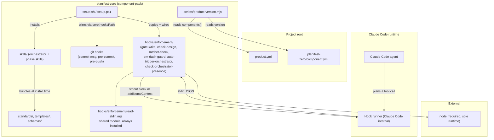

# Dependency Graph

Last updated: 0000040-setup-json-checks-and-park

## Component dependency diagram

---

## Edges that matter

**Every enforcement hook imports `read-stdin.mjs`.** All six hooks share the one module. Setup copies `hooks/enforcement/` as a unit, so the import always resolves.

**Setup wires six hooks into `.claude/settings.json`.** `gate-write`, `ratchet-check`, and `em-dash-guard` run on `PreToolUse` for Write and Edit. `auto-trigger-orchestrator`, `check-orchestrator-presence`, and `check-design` run on `UserPromptSubmit`, in that order. Setup finds its own entries by module name on any matcher, and replaces a non-array event value with a warning.

**Nothing leaves the machine.** No hook or script makes an outbound network call. The framework has no external integration besides `node`.

**`product-version.mjs` reads `components[].id` and each component's `version`.** It derives the product version under `versionPolicy: max-component-version`. No code reads the top-level `id` in `product.yml`. The orchestrator's discovery hard stop requires it.

**Node is the sole runtime.** Every hook is a `.mjs` file invoked as `node <script>`. There is no `jq` dependency and no bash entry point, so the hooks run identically on macOS, Linux, and Windows.
