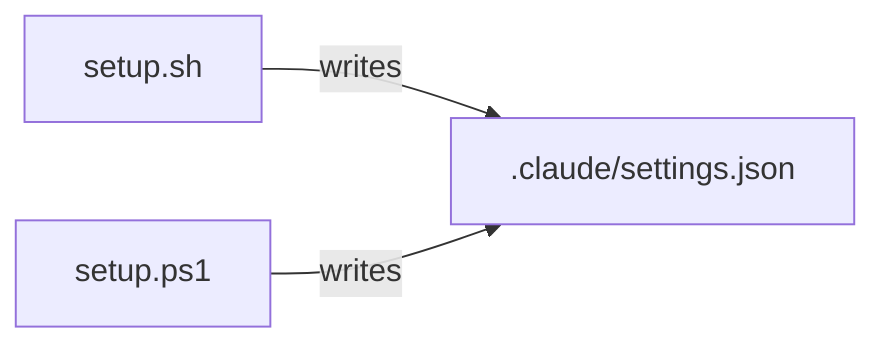

# Execution Plan - setup-hook-filter-fixes

> Every requirement must be traceable to a user story or acceptance criterion.

**Skill:** [plan](../skills/planifest-plan/SKILL.md)
**Feature:** 0000038-setup-hook-filter-fixes
**Version:** 0.5.1
**Status:** active

## Active Skills

None.

## Functional Requirements Directory

Functional requirements are split into individual files, one user story per file, at `plan/current/requirements/`.

| File | Requirement |
|------|------------|
| [req-001-per-command-filter.md](requirements/req-001-per-command-filter.md) | Both scripts remove only Planifest commands from a hook entry (US-001) |
| [req-002-userpromptsubmit-parity.md](requirements/req-002-userpromptsubmit-parity.md) | `setup.sh` matches `UserPromptSubmit` commands by path boundary (US-002) |

## Non-Functional Requirements

| ID | Category | Requirement | Target | Measurement |
|----|----------|------------|--------|-------------|
| NFR-001 | Correctness | No user command lost | 0 user commands lost across the planted-entry cases | New `.sh` and `.ps1` suites |
| NFR-002 | Parity | Both scripts give the same result | Identical entries from the same fixtures | The same fixtures in both suites |
| NFR-003 | Regression | No suite breaks | 0 failing suites locally and in all four CI jobs | `planifest-zero/tests/run-tests.sh` and GitHub Actions |
| NFR-004 | Security | Setup never logs `settings.json` contents | 0 lines of file contents in setup output | Existing logging-policy checks |

## API Summary

Not applicable. The feature changes no API.

## Data Model Summary

Not applicable. The component owns no data. Setup edits the consumer's `.claude/settings.json`.

## Component Interactions

## Delivery order

1. req-002 and req-001 change the same `setup.sh` filter, so one implementer builds both in `setup.sh`.
2. A second implementer changes `setup.ps1` in parallel, against the same fixtures.
3. The `.sh` and `.ps1` suites share one fixture set.

## Assumptions

| ID | Assumption | Impact if Wrong |
|----|-----------|----------------|
| A-001 | No user relies on setup removing their non-Planifest commands | A stale user command stays, and the user removes it by hand |

## Open Questions

None.
