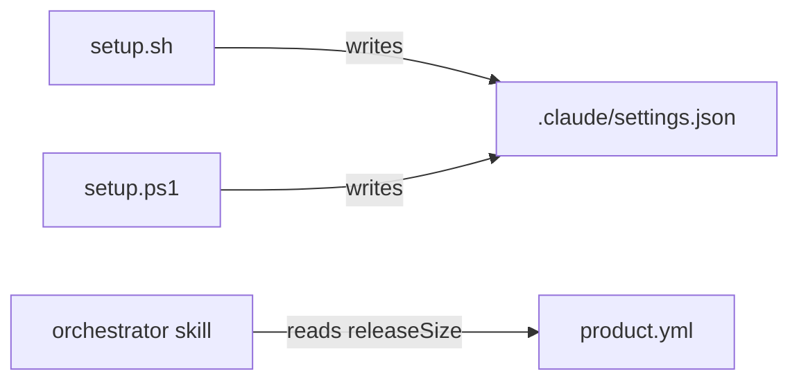

# Execution Plan - setup-hardening-release-sizing

> Every requirement must be traceable to a user story or acceptance criterion.

**Skill:** [plan](../skills/planifest-plan/SKILL.md)
**Feature:** 0000039-setup-hardening-release-sizing
**Version:** 0.6.0
**Status:** active

## Active Skills

None.

## Functional Requirements Directory

Functional requirements are split into individual files, one user story per file, at `plan/current/requirements/`.

| File | Requirement |
|------|------------|
| [req-001-invalid-json.md](requirements/req-001-invalid-json.md) | Both scripts stop on invalid JSON with one fixed message and an unchanged file (US-001) |
| [req-002-single-object-hooks.md](requirements/req-002-single-object-hooks.md) | Both scripts filter a single-object `hooks` value as a one-item array (US-002) |
| [req-003-ps1-json-depth.md](requirements/req-003-ps1-json-depth.md) | `setup.ps1` writes `settings.json` with `-Depth 100` (US-003) |
| [req-004-release-size-setting.md](requirements/req-004-release-size-setting.md) | Discovery sizes a release from an optional `releaseSize` in `product.yml` (US-004) |

## Non-Functional Requirements

| ID | Category | Requirement | Target | Measurement |
|----|----------|------------|--------|-------------|
| NFR-001 | Security | Setup never prints `settings.json` contents | 0 bytes of a planted value in stdout or stderr | Planted-value cases in the `.sh` and `.ps1` suites |
| NFR-002 | Parity | Both scripts give the same result | Identical results from the same input | The same cases in both suites |
| NFR-003 | Regression | No suite breaks | 0 failing suites locally and in all four CI jobs | `planifest-zero/tests/run-tests.sh` and GitHub Actions |

## API Summary

Not applicable. The feature changes no API.

## Data Model Summary

Not applicable. The component owns no data. Setup edits the consumer's `.claude/settings.json`. The orchestrator reads the consumer's `product.yml`.

## Component Interactions

## Delivery order

1. req-001 and req-002 change the same hook install step in each script. One implementer builds both in `setup.sh` with the `.sh` suite.
2. A second implementer builds req-001, req-002, and req-003 in `setup.ps1` with the `.ps1` suite, in parallel.
3. A third implementer builds req-004 in the orchestrator skill and the two feature brief templates, with a text suite, in parallel.

## Assumptions

| ID | Assumption | Impact if Wrong |
|----|-----------|----------------|
| A-001 | A file count estimated at discovery is close enough to size a release | A release runs over or under budget, and the human corrects the fill |

## Open Questions

None.
