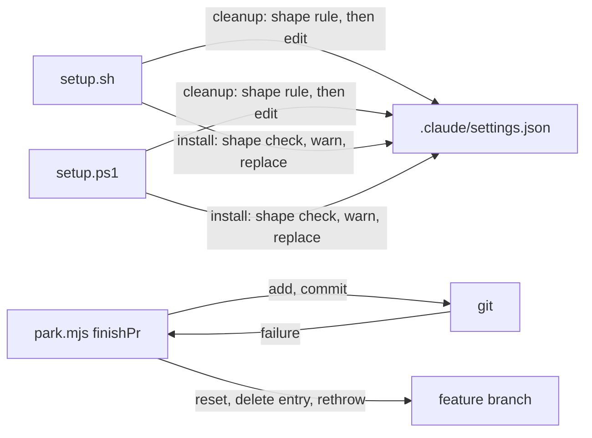

# Execution Plan - setup-cleanup-and-park-hardening

> Every requirement must be traceable to a user story or acceptance criterion.

**Skill:** [plan](../skills/planifest-plan/SKILL.md)
**Feature:** 0000041-setup-cleanup-and-park-hardening
**Wave:** 1
**Version:** 0.8.0
**Status:** active

## Existing system

This is a standard-iterative run on `planifest-zero`, the framework pack. Three pieces of it change.

- `setup.sh` and `setup.ps1` install hook wiring into the consumer's `.claude/settings.json`.
  - Each script first runs a legacy telemetry cleanup (0000033 ADR-002). The cleanup runs before the hook install step.
  - The hook install step applies the 0000040 shape check. It prints one fixed line and exits 1 when the file is not a settings object.
  - The install step also replaces a non-array `hooks.PreToolUse` or `hooks.UserPromptSubmit` (0000037 ADR-003). Today it warns with `Old value:` and the serialised value.
- `planifest-zero/skills/planifest-orchestrator/scripts/park.mjs` shelves a feature (0000040 req-004). `finishPr` writes a backlog entry, adds it, commits it on a chore branch, and pushes. `onFeatureBranch` returns to the feature branch on any error.
- `planifest-zero/tests/` holds the shell and PowerShell suites. `run-tests.sh` and `run-tests.ps1` run them, and GitHub Actions runs both.

What changes:

- The cleanup in both scripts applies the shape rule first and skips in silence on a parse or shape failure (REQ-001, REQ-002).
- The non-array warning in both scripts names the event and the file and drops the old value (REQ-003).
- `finishPr` unstages and deletes the entry when the local add or commit fails (REQ-004).

What stays the same:

- The shape check line, the invalid JSON line, and exit 1 (0000040 ADR-002).
- The cleanup still runs on every setup run and still warns on a real read or write failure (0000033 ADR-002).
- Park's push and `gh` failure paths.

## Active Skills

None.

## Functional Requirements Directory

Functional requirements are split into individual files, one user story per file, at `plan/current/requirements/`.

| File | Requirement |
|------|------------|
| [req-001-setup-sh-cleanup-skip.md](requirements/req-001-setup-sh-cleanup-skip.md) | `setup.sh` cleanup skips a file that fails the parse or shape rule, so only the shape check line appears (US-001) |
| [req-002-setup-ps1-cleanup-skip.md](requirements/req-002-setup-ps1-cleanup-skip.md) | `setup.ps1` cleanup skips the same files and never rewrites a rejected file (US-002) |
| [req-003-non-array-warning-no-value.md](requirements/req-003-non-array-warning-no-value.md) | Both scripts warn with the event and the file and never print the old value (US-003) |
| [req-004-park-local-failure-cleanup.md](requirements/req-004-park-local-failure-cleanup.md) | Park unstages and deletes the entry when the local add or commit fails, then returns to the feature branch (US-004) |

## Non-Functional Requirements

| ID | Category | Requirement | Target | Measurement |
|----|----------|------------|--------|-------------|
| NFR-001 | Security | No setup output prints a hook value or `settings.json` content | 0 bytes of a planted secret in stdout or stderr. Each fault prints its exact fixed stderr line and no other line. | Tests plant `PLANTED-SECRET` and assert the exact stderr lines in both suites |
| NFR-002 | Integrity | A rejected `settings.json` stays unchanged | 0 bytes differ for `null`, `["x"]`, `{"hooks":"text"}`, `{bad`, and `{"a":1,"A":2}` | Tests compare the file bytes before and after each run |
| NFR-003 | Parity | Both scripts print the same non-array warning text | Identical line for `PreToolUse` and `UserPromptSubmit` | One parity test asserts the exact line from each script |
| NFR-004 | Safety | A failed park commit leaves a clean feature branch | 0 entry files and 0 staged changes after the failure. `park.md` stays committed. | Park suite with a failing `pre-commit` hook |
| NFR-005 | Regression | No suite breaks | 0 failing suites locally and in CI | `planifest-zero/tests/run-tests.sh` and GitHub Actions |

## API Summary

Not applicable. The feature adds or changes no API, and no OpenAPI spec exists or is needed.

## Data Model Summary

The feature changes no schema.

| Entity | Owner Component | Key Fields | Relationships |
|--------|----------------|------------|--------------|
| `.claude/settings.json` (hook wiring) | planifest-zero setup | `hooks.PreToolUse`, `hooks.UserPromptSubmit`, telemetry entries | None. Setup reads and writes it, and no other component does. |
| `plan/` working state | planifest-zero orchestrator | `park.md`, backlog entries | None. Park writes one backlog entry and removes it on a local failure. |

## Component Interactions

## Implementation order

REQ-003 edits the warning lines in both setup scripts. REQ-001 edits `setup.sh` and REQ-002 edits `setup.ps1`. Work splits by file, so no two implementers edit the same file, as in 0000039 and 0000040.

| Agent | Requirements | Files | Runs |
|-------|-------------|-------|------|
| A | REQ-001, the `setup.sh` half of REQ-003 | `setup.sh`, the `.sh` tests, the parity test | Parallel with B and C |
| B | REQ-002, the `setup.ps1` half of REQ-003 | `setup.ps1`, the `.ps1` tests | Parallel with A and C |
| C | REQ-004 | `park.mjs`, `test-0000040-req-004-005-park.sh` | Parallel with A and B |

1. One batch runs three implementers in parallel. They touch different files and share no state.
   - Agent A changes `remove_legacy_telemetry_wiring` and the warning in `install_enforcement_hooks`.
   - Agent B changes `Remove-LegacyTelemetryWiring` and the warning in `Merge-EnforcementHookSettings`.
   - Agent C changes `finishPr` in `park.mjs`.
2. The parity test reads both scripts' warning text as files, so it passes once A and B both finish.
3. Each requirement follows the TDD loop. The test writer confirms RED, the implementer confirms GREEN, and the refactor pass follows.
4. PowerShell tests run only in CI, because `pwsh` is not installed locally. They skip locally.
   - For REQ-002, the RED check for 0000128 runs in CI, because nobody has run the PowerShell reading.
   - For the REQ-003 `.ps1` test changes, GREEN is confirmed in CI.
5. P4 reruns setup to refresh `.claude/skills/` and checks the two `park.mjs` copies with `diff`.

## Tests to add or change

| Test file | Change | Requirement |
|-----------|--------|-------------|
| `planifest-zero/tests/test-0000041-req-001-sh-cleanup-skip.sh` | Add. Cases for `null`, `["x"]`, `{"hooks":"text"}`, and `{bad`. Assert the exact stderr line, exit 1, no cleanup line, and byte-identical file. Also assert a valid file still has its telemetry entry removed, and a write failure still warns. | REQ-001 |
| `planifest-zero/tests/test-0000041-req-002-ps1-cleanup-skip.ps1` | Add. Cases for the one-item array holding a telemetry entry, `null`, `{"hooks":"text"}`, `{bad`, and `{"a":1,"A":2}`. Assert the exact line and byte-identical file. Skips locally. | REQ-002 |
| `planifest-zero/tests/test-0000037-req-008-non-array-hook-events.sh` | Change. Assert the new warning line and the absence of the planted value. | REQ-003 |
| `planifest-zero/tests/regression/test-0000037-req-008-non-array-hook-events.sh` | Change. Same as above. | REQ-003 |
| `planifest-zero/tests/test-0000037-req-008-non-array-hook-events.ps1` | Change. Same as above. Skips locally. | REQ-003 |
| `planifest-zero/tests/test-0000039-req-001-003-ps1-setup-hardening.ps1` | Change. The `Old value:` assertion at line 221 checks that the value is absent. Skips locally. | REQ-003 |
| `planifest-zero/tests/test-0000041-req-003-warning-parity.sh` | Add. Assert the identical line for both events and both scripts. The `.ps1` half skips locally. | REQ-003 |
| `planifest-zero/tests/test-0000040-req-004-005-park.sh` | Change. Add a failing `pre-commit` hook case and assert the five outcomes in REQ-004. Existing cases stay as they are. | REQ-004 |

New test file names are proposals. The test writer may adjust them to match the suite's naming and must record the final names in `plan/current/build-log.md`.

## Assumptions

| ID | Assumption | Impact if Wrong |
|----|-----------|----------------|
| A-001 | A failing `pre-commit` hook in a temporary repo forces the chore commit to fail | The park test needs another failure, such as a read-only index |
| A-002 | The PowerShell reading of 0000128 is correct | The new `.ps1` test passes before the fix, and the test writer must confirm RED in CI |
| A-003 | The warning line has the same two leading spaces in both scripts | The parity test fails, and the text is fixed in the script that drifted |

## Open Questions

None.

## Decisions

- [ADR-001](adr/ADR-001-stack-unchanged.md): the stack is unchanged.
- [ADR-002](adr/ADR-002-cleanup-skips-unreadable-settings.md): the cleanup skips an unreadable or rejected settings file.
- [ADR-003](adr/ADR-003-non-array-warning-drops-old-value.md): the non-array warning drops the old value.
