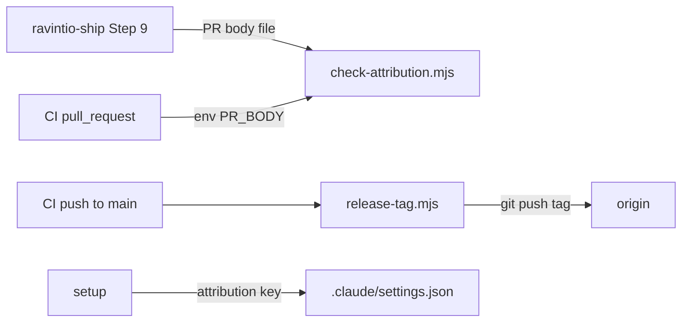

# Execution Plan - release hygiene

> Every requirement must be traceable to a user story or acceptance criterion.

**Skill:** plan
**Feature:** 0000169-release-hygiene
**Version:** 0.14.0
**Status:** active

## Active Skills

| Skill | Scope | Purpose |
|-------|-------|---------|
| None | | No capability skill applies |

## Decisions referenced

| ADR | Decision |
|-----|----------|
| ADR-001 | The stack stays as declared, with no new dependency |
| ADR-002 | CI tags the merge commit on `main` |
| ADR-003 | One attribution check serves ship and CI |
| ADR-004 | Setup turns off host attribution when unset |

## Functional Requirements Directory

| File | Requirement | Source |
|------|------------|--------|
| [req-001-attribution-ban-text.md](requirements/req-001-attribution-ban-text.md) | Ban attribution in PR descriptions and name the host lines | US-001 |
| [req-002-attribution-check-script.md](requirements/req-002-attribution-check-script.md) | New `check-attribution.mjs`, and host-line patterns in `commit-msg` | US-001 |
| [req-003-attribution-check-in-ship-and-ci.md](requirements/req-003-attribution-check-in-ship-and-ci.md) | Ship and `validate-branch` run the check on the PR body | US-001 |
| [req-004-setup-attribution-setting.md](requirements/req-004-setup-attribution-setting.md) | Setup sets `attribution` when absent, in both shells | US-002 |
| [req-005-release-tag-script.md](requirements/req-005-release-tag-script.md) | New `release-tag.mjs` | US-003 |
| [req-006-release-tag-ci-and-ship-flow.md](requirements/req-006-release-tag-ci-and-ship-flow.md) | `release-tag` CI job, and ship and docs match | US-003 |

## Build order

Batch 1 runs three tracks in parallel. Each track owns its files.

1. **Track A:** REQ-002, then REQ-001. Files: `check-attribution.mjs`, `hooks/commit-msg`, `standard-boot.md`, `commit-standards.md`.
2. **Track B:** REQ-004. Files: `setup.sh`, `setup.ps1`.
3. **Track C:** REQ-005. File: `release-tag.mjs`.

Batch 2 runs one track, because REQ-003 and REQ-006 both edit the ship skill and both workflow files.

4. **Track D:** REQ-003, then REQ-006. Files: ship `SKILL.md`, both workflow files, `roadmap-standards.md`, `pipeline-reference.md`, and `custom-004`.

Batch 3 runs the full suite under Bash 5 and under macOS Bash 3.2 with `env -i`, then updates the living docs.

## Non-Functional Requirements

| ID | Category | Requirement | Target | Measurement |
|----|----------|------------|--------|-------------|
| NFR-001 | Security | PR body never inside a `run:` script | 0 occurrences of `github.event.pull_request.body` in `run:` | REQ-003 test |
| NFR-002 | Security | Write token scope | Only `release-tag` holds `contents: write` | REQ-006 test |
| NFR-003 | Privacy | Check output | No line text in output | REQ-002 test |
| NFR-004 | Regression | Existing suites on every shell | All pass on Bash 3.2, Bash 5, Windows PowerShell 5.1, and PowerShell 7 | CI matrix and a local `env -i` run |

## API Summary

Not applicable. The pack exposes no API.

## Data Model Summary

Not applicable. No component owns data.

## Component Interactions

## Assumptions

| ID | Assumption | Impact if Wrong |
|----|-----------|----------------|
| A-001 | Claude Code honours empty `attribution.commit` and `attribution.pr` | The host keeps asking for the lines. The check and hook still catch them. |
| A-002 | `GITHUB_TOKEN` with `contents: write` can push a tag | The job fails visibly, and the human tags by hand |

## Open Questions

None.
