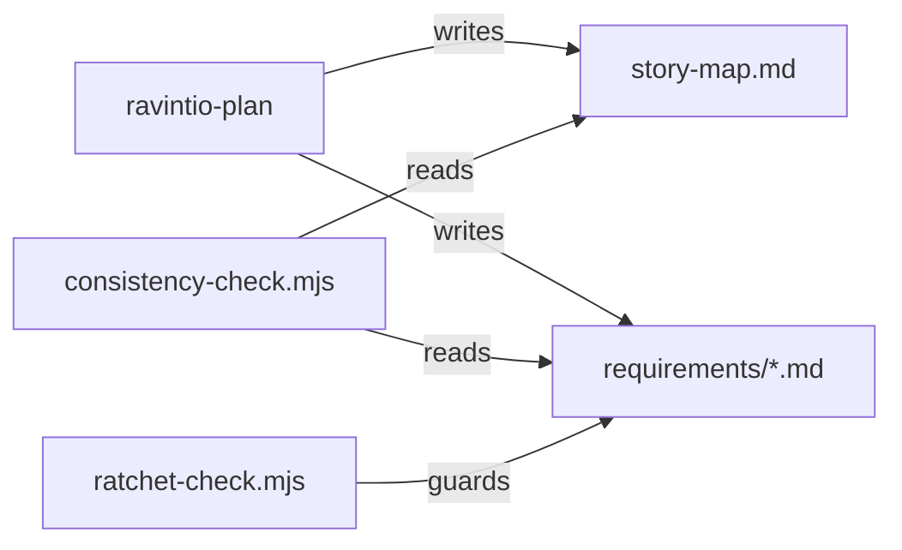

# Execution Plan - story mapping and Gherkin

> Every requirement must be traceable to a user story or acceptance criterion.

**Skill:** plan
**Feature:** 0000170-story-mapping-and-gherkin
**Version:** 0.15.0
**Status:** active

## Active Skills

| Skill | Scope | Purpose |
|-------|-------|---------|
| None | | No capability skill applies |

## Decisions referenced

| ADR | Decision |
|-----|----------|
| ADR-001 | The stack stays as declared, with no new dependency |
| ADR-002 | P1 owns the story mapping pass |
| ADR-003 | A criterion stays one checkbox line with Gherkin steps under it |
| ADR-004 | The ratchet guards Gherkin step lines |

## Functional Requirements Directory

| File | Requirement | Source |
|------|------------|--------|
| [req-001-story-map-pass.md](requirements/req-001-story-map-pass.md) | Story map template and the P1 mapping pass | US-001 |
| [req-002-gherkin-criteria.md](requirements/req-002-gherkin-criteria.md) | Gherkin criteria in the requirement template and plan skill | US-002 |
| [req-003-gherkin-consistency-rule.md](requirements/req-003-gherkin-consistency-rule.md) | Consistency check flags malformed Gherkin criteria | US-003 |
| [req-004-story-map-consistency-rule.md](requirements/req-004-story-map-consistency-rule.md) | Consistency check flags story map gaps | US-004 |
| [req-005-ratchet-gherkin-guard.md](requirements/req-005-ratchet-gherkin-guard.md) | Ratchet guards step lines, and the 0000016 fixtures move to Gherkin | US-005 |

## Build order

Batch 1 runs two tracks in parallel. Each track owns its files.

1. **Track A:** REQ-001, then REQ-002. Files: `skills/ravintio-plan/SKILL.md`, `templates/story-map.template.md`, `templates/requirement.template.md`.
2. **Track B:** REQ-003, REQ-004, then REQ-005. Files: `scripts/consistency-check.mjs`, `hooks/enforcement/ratchet-check.mjs`, and both copies of `test-0000016-pipeline-governance.sh`. One track owns them, because REQ-004 and REQ-005 both change the 0000016 fixtures.

Batch 2 runs the full suite under Bash 5 and under macOS Bash 3.2 with `env -i`, then updates the living docs.

## Non-Functional Requirements

| ID | Category | Requirement | Target | Measurement |
|----|----------|------------|--------|-------------|
| NFR-001 | Security | Ratchet parsing of untrusted tool input | No shell calls added, no file content printed beyond the removed line | REQ-005 test and review |
| NFR-002 | Regression | Existing suites on every shell | All pass on Bash 3.2, Bash 5, Windows PowerShell 5.1, and PowerShell 7 | CI matrix and a local `env -i` run |
| NFR-003 | Compatibility | Pack install footprint | 0 new dependencies | ADR-001 and `package.json` absence |

## API Summary

Not applicable. The pack exposes no API.

## Data Model Summary

Not applicable. No component owns data.

## Component Interactions

## Assumptions

| ID | Assumption | Impact if Wrong |
|----|-----------|----------------|
| A-001 | Plain Markdown lines are enough for Gherkin | A later release adds a `.feature` export |

## Open Questions

None.
