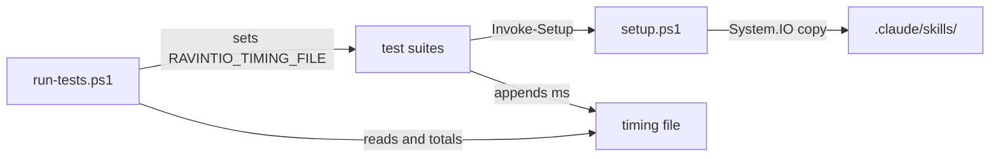

# Execution Plan - faster setup.ps1 tests

> Every requirement must be traceable to a user story or acceptance criterion.

**Skill:** plan
**Feature:** 0000171-faster-setup-ps1-tests
**Version:** 0.16.0
**Status:** active

## Active Skills

| Skill | Scope | Purpose |
|-------|-------|---------|
| None | | No capability skill applies |

## Decisions referenced

| ADR | Decision |
|-----|----------|
| ADR-001 | The stack stays as declared, with no new dependency |
| ADR-002 | `setup.ps1` copies files with `System.IO` calls |
| ADR-003 | Suites report setup time through a file the runner names |

## Functional Requirements Directory

| File | Requirement | Source |
|------|------------|--------|
| [req-001-setup-ps1-speed-target.md](requirements/req-001-setup-ps1-speed-target.md) | CI `setup.ps1` total under 105 s | US-001 |
| [req-002-install-tree-parity.md](requirements/req-002-install-tree-parity.md) | `System.IO` copies with an unchanged installed tree | US-002 |
| [req-003-timing-total.md](requirements/req-003-timing-total.md) | Runner prints the `setup.ps1` total | US-003 |

## Build order

Batch 1 runs two tracks in parallel. Each track owns its files.

1. **Track A:** REQ-002. Files: `ravintio-zero/setup.ps1` and a new suite `tests/test-0000171-req-002-install-tree-parity.ps1`.
2. **Track B:** REQ-003. Files: `tests/run-tests.ps1`, `tests/helpers/setup-workspace.ps1`, and a new suite `tests/test-0000171-req-003-timing-total.ps1`.

Batch 2 runs REQ-001 AC-2 as a local profile, then the full suite on both shells. REQ-001 AC-1 is read from the step PR's CI logs in R-D Advance, before the merge.

## Non-Functional Requirements

| ID | Category | Requirement | Target | Measurement |
|----|----------|------------|--------|-------------|
| NFR-001 | Performance | `setup.ps1` time across both Windows CI jobs | Under 105 s, from 210 s | REQ-003 total lines in the step PR's CI logs |
| NFR-002 | Regression | Existing suites on every shell | All pass on Bash 3.2, Bash 5, Windows PowerShell 5.1, and PowerShell 7 | CI matrix and a local `env -i` run |
| NFR-003 | Compatibility | Pack install footprint | 0 new dependencies | ADR-001 |

## API Summary

Not applicable. The pack exposes no API.

## Data Model Summary

Not applicable. No component owns data.

## Component Interactions

## Assumptions

| ID | Assumption | Impact if Wrong |
|----|-----------|----------------|
| A-001 | Cmdlet overhead per file on Windows is at least as high as on macOS | The CI total misses 105 s and the step stops before merge |

## Open Questions

None.
