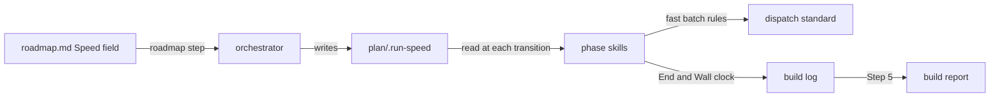

# Execution Plan - subagent acceleration

> Every requirement must be traceable to a user story or acceptance criterion.

**Skill:** plan
**Feature:** 0000172-subagent-acceleration
**Version:** 0.17.0
**Status:** active

## Active Skills

| Skill | Scope | Purpose |
|-------|-------|---------|
| None | | No capability skill applies |

## Decisions referenced

| ADR | Decision |
|-----|----------|
| ADR-001 | The stack stays as declared, with no new dependency |
| ADR-002 | The run speed lives in its own sentinel file |
| ADR-003 | Each phase skill lists its own fast batch |

## Functional Requirements Directory

| File | Requirement | Source |
|------|------------|--------|
| [req-001-run-speed-setting.md](requirements/req-001-run-speed-setting.md) | Run-speed question and `plan/.run-speed` | US-001 |
| [req-002-fast-batches-per-phase.md](requirements/req-002-fast-batches-per-phase.md) | Fast batch rules and per-phase lists | US-002 |
| [req-003-phase-timing.md](requirements/req-003-phase-timing.md) | End and wall-clock time per phase | US-003 |

## Build order

Batch 1 runs two tracks in parallel. Each track owns its files.

1. **Track A:** REQ-002. Files: `standards/agent-dispatch-standards.md`, the plan, implement, and validate-and-accept skills, and a new suite `tests/test-0000172-req-002-fast-batches.sh`.
2. **Track B:** REQ-003. Files: `templates/build-log.template.md` and a new suite `tests/test-0000172-req-003-phase-timing.sh`.

The orchestrator writes REQ-001 inline meanwhile. It owns the orchestrator skill, the ship skill, the roadmap standards and template, and `tests/test-0000172-req-001-run-speed.sh`. It then adds the REQ-002 and REQ-003 lines in the orchestrator and ship skills, because those files belong to its track.

## Non-Functional Requirements

| ID | Category | Requirement | Target | Measurement |
|----|----------|------------|--------|-------------|
| NFR-001 | Regression | Existing suites on every shell | All pass on Bash 3.2, Bash 5, Windows PowerShell 5.1, and PowerShell 7 | CI matrix and a local `env -i` run |
| NFR-002 | Compatibility | Runs with no `plan/.run-speed` | Behave as before, at `standard` | REQ-001 AC-2 |
| NFR-003 | Compatibility | Pack install footprint | 0 new dependencies | ADR-001 |

## API Summary

Not applicable. The pack exposes no API.

## Data Model Summary

Not applicable. No component owns data.

## Component Interactions

## Assumptions

| ID | Assumption | Impact if Wrong |
|----|-----------|----------------|
| A-001 | Phase agents follow a listed batch more reliably than a general rule | Fast runs spawn no more agents, and the build report shows it |

## Open Questions

None.
