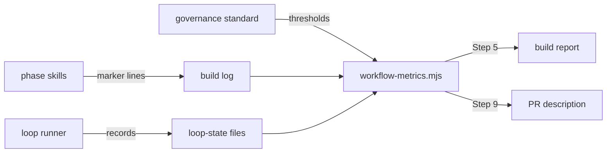

# Execution Plan - workflow governance gates

> Every requirement must be traceable to a user story or acceptance criterion.

**Skill:** plan
**Feature:** 0000173-workflow-governance-gates
**Version:** 0.18.0
**Status:** active

## Active Skills

| Skill | Scope | Purpose |
|-------|-------|---------|
| None | | No capability skill applies |

## Decisions referenced

| ADR | Decision |
|-----|----------|
| ADR-001 | The stack stays as declared, with no new dependency |
| ADR-002 | Fixed marker lines are the only metric source |
| ADR-003 | Thresholds live in a pack standard, and the gate only reports |

## Functional Requirements Directory

| File | Requirement | Source |
|------|------------|--------|
| [req-001-workflow-metrics-script.md](requirements/req-001-workflow-metrics-script.md) | Script derives four metrics | US-001 |
| [req-002-thresholds-and-report-only-gate.md](requirements/req-002-thresholds-and-report-only-gate.md) | Thresholds table and report-only gate | US-002 |
| [req-003-metric-markers.md](requirements/req-003-metric-markers.md) | Marker lines in the phase skills | US-003 |
| [req-004-governance-report-at-ship.md](requirements/req-004-governance-report-at-ship.md) | Section in the build report and PR body | US-004 |

## Build order

Batch 1 runs two tracks in parallel. Each track owns its files.

1. **Track A:** REQ-001 and REQ-002. Files: `scripts/workflow-metrics.mjs`, `standards/workflow-governance-standards.md`, and new suites `tests/test-0000173-req-001-workflow-metrics-script.sh` and `tests/test-0000173-req-002-thresholds-gate.sh`. Each suite builds its fixture run folders in a temporary directory.
2. **Track B:** REQ-003 and REQ-004. Files: the implement, validate-and-accept, orchestrator, and ship skills, `references/orchestrator-mid-pipeline-changes.md`, and new suites `tests/test-0000173-req-003-metric-markers.sh` and `tests/test-0000173-req-004-ship-governance-report.sh`.

The orchestrator then updates `component.yml`, `pipeline-reference.md`, and the docs that list the scripts and standards.

## Non-Functional Requirements

| ID | Category | Requirement | Target | Measurement |
|----|----------|------------|--------|-------------|
| NFR-001 | Regression | Existing suites on every shell | All pass on Bash 3.2, Bash 5, Windows PowerShell 5.1, and PowerShell 7 | CI matrix and a local `env -i` run |
| NFR-002 | Performance | Script run time | Under 1 second on a 1,000-line build log | REQ-001 suite timing |
| NFR-003 | Compatibility | Pack install footprint | 0 new dependencies | ADR-001 |
| NFR-004 | Compatibility | Runs with no markers | Report 0 for each marker metric and no breach | Scope Lock first-run path |

## API Summary

Not applicable. The pack exposes no API.

## Data Model Summary

Not applicable. No component owns data.

## Component Interactions

## Assumptions

| ID | Assumption | Impact if Wrong |
|----|-----------|----------------|
| A-001 | Agents write the marker lines when the skill text tells them to | The metrics read low, and the report says counts come from markers only |

## Open Questions

None.
