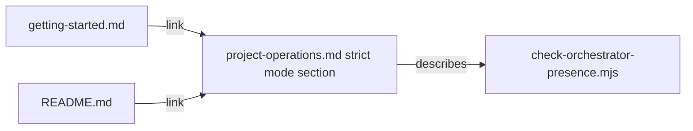

# Execution Plan - explain strict mode

> Every requirement must be traceable to a user story or acceptance criterion.

**Skill:** plan
**Feature:** 0000185-explain-strict-mode
**Version:** 0.18.1
**Status:** active

## Active Skills

| Skill | Scope | Purpose |
|-------|-------|---------|
| None | | No capability skill applies |

## Decisions referenced

| ADR | Decision |
|-----|----------|
| ADR-001 | Rewrite the existing strict mode section, with no new dependency |

## Functional Requirements Directory

| File | Requirement | Source |
|------|------------|--------|
| [req-001-strict-mode-section.md](requirements/req-001-strict-mode-section.md) | Strict mode section explains both files | US-001 |
| [req-002-strict-mode-links.md](requirements/req-002-strict-mode-links.md) | Two links reach the section | US-002 |

## Build order

One track, inline. Both requirements share the anchor, and the whole change is under 40 lines.

1. REQ-001: new suite `tests/test-0000185-req-001-strict-mode-section.sh`, then the rewrite of `project-operations.md`.
2. REQ-002: new suite `tests/test-0000185-req-002-strict-mode-links.sh`, then the two link edits.

## Non-Functional Requirements

| ID | Category | Requirement | Target | Measurement |
|----|----------|------------|--------|-------------|
| NFR-001 | Regression | Existing suites on every shell | All pass on Bash 3.2, Bash 5, Windows PowerShell 5.1, and PowerShell 7 | CI matrix and a local `env -i` run |
| NFR-002 | Accuracy | Claims that match the hook | Every claim in the section matches `check-orchestrator-presence.mjs` | P3 verification |

## API Summary

Not applicable. The pack exposes no API.

## Data Model Summary

Not applicable. No component owns data.

## Component Interactions

## Assumptions

| ID | Assumption | Impact if Wrong |
|----|-----------|----------------|
| A-001 | The heading text stays the same | The links break, and the suite fails |

## Open Questions

None.
