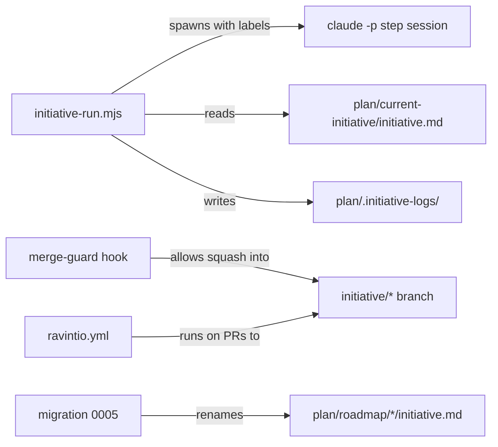

# Execution Plan - name the roadmap initiative

> Every requirement must be traceable to a user story or acceptance criterion.

**Skill:** plan
**Feature:** 0000189-name-the-roadmap-initiative
**Version:** 0.19.0
**Status:** active

## Active Skills

| Skill | Scope | Purpose |
|-------|-------|---------|
| None | | No capability skill applies |

## Decisions referenced

| ADR | Decision |
|-----|----------|
| ADR-001 | Keep the declared stack, with no new dependency |
| ADR-002 | Clean break with migration 0005, and no aliases |
| ADR-003 | Activation keeps moving the initiative to a fixed path |
| ADR-004 | Short `initiative` names and `I-A` to `I-E` prefixes |
| ADR-005 | Old-name guard with an exact-path allowlist |

## Functional Requirements Directory

| File | Requirement | Source |
|------|------------|--------|
| [req-001-glossary.md](requirements/req-001-glossary.md) | One glossary defines the terms and states | US-001 |
| [req-002-renamed-names.md](requirements/req-002-renamed-names.md) | Every name uses its initiative form | US-002 |
| [req-003-initiative-prefixes.md](requirements/req-003-initiative-prefixes.md) | Stage messages use `I-A` to `I-E` | US-003 |
| [req-004-initiative-states.md](requirements/req-004-initiative-states.md) | Template status takes the five states | US-004 |
| [req-005-consumer-migration.md](requirements/req-005-consumer-migration.md) | Migration 0005 moves consumer drafts and CI | US-005 |
| [req-006-old-variable-stop.md](requirements/req-006-old-variable-stop.md) | The driver stops on an old variable | US-002 |
| [req-007-old-name-guard.md](requirements/req-007-old-name-guard.md) | A search test guards against old names | US-006 |
| [req-008-open-backlog-entries.md](requirements/req-008-open-backlog-entries.md) | Open backlog entries use new terms | US-007 |
| [req-009-skills-refresh.md](requirements/req-009-skills-refresh.md) | Installed skills match the pack skills | US-008 |

## Build order

Four tracks run in parallel. Two steps follow them in sequence.

| Track | Requirements | Files | Why it is one track |
|-------|--------------|-------|---------------------|
| A: code rename | REQ-002, REQ-003, REQ-006 | `scripts/`, `hooks/`, `.github/workflows/ravintio.yml`, `component.yml`, existing tests | The driver, labels, hook, and tests reference each other |
| B: prose and template | REQ-001, REQ-004, prose part of REQ-002 and REQ-003 | `standards/`, `templates/`, `skills/`, pack docs, `docs/`, `ravintio-overrides/instructions/`, `CLAUDE.md` | Shared terms across the same documents |
| C: migration | REQ-005 | `migrations/0005-*`, new test | New files only |
| D: backlog | REQ-008 | `plan/backlog/` | No overlap with other tracks |

Tracks A and B share no file. Track A owns test files, and track B owns no test file.

After the four tracks:

1. REQ-007: the guard test, with its allowlist, once every old name is gone.
2. REQ-009: run setup and compare `.claude/skills/` with `ravintio-zero/skills/`. Recommend a context clear afterwards, as agreed at P0.

## Non-Functional Requirements

| ID | Category | Requirement | Target | Measurement |
|----|----------|------------|--------|-------------|
| NFR-001 | Completeness | No old name outside the allowlist | 0 hits | The REQ-007 guard test |
| NFR-002 | Regression | Full suite on every platform, with no test removed | All pass on Linux, macOS, and Windows. Test file count is 167 or more | CI on the PR, and a count of files in `ravintio-zero/tests/` before and after |
| NFR-003 | Privacy | Step log permissions under the new folder | Folder mode 700, log mode 600 | The existing step log test, renamed |

## API Summary

Not applicable. The pack exposes no API.

## Data Model Summary

Not applicable. No component owns data. `ravintio-zero` owns all pack files.

## Component Interactions

## Assumptions

| ID | Assumption | Impact if Wrong |
|----|-----------|----------------|
| A-001 | This repo is the only consumer of the pack today | Another consumer must run migration 0005, which exists |
| A-002 | No initiative is active while this feature runs | A running driver breaks on the new names |
| A-003 | The design's "four initiative states" means the five it lists | The glossary or status field misses a state |
| A-004 | Removing the `PLANIFEST_ROADMAP_*` fallback breaks no one, because migration 0004 already retired Planifest names | A consumer that still sets them sees the driver stop, with the new name in the message |

## Open Questions

None.
