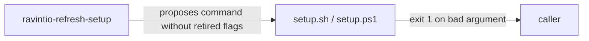

# Execution Plan - setup argument checks

> Every requirement is traceable to a user story or acceptance criterion.

**Skill:** [plan](../skills/ravintio-plan/SKILL.md)
**Feature:** 0000196-setup-argument-checks
**Version:** 0.20.0
**Status:** active

## Active Skills

| Skill | Scope | Purpose |
|-------|-------|---------|
| None | none | none |

## Functional Requirements Directory

Functional requirements are split into individual files, one user story per file, at `plan/current/requirements/`.

| File | Requirement |
|------|------------|
| [req-001-validate-tool-first.md](requirements/req-001-validate-tool-first.md) | Reject an unknown tool before any change |
| [req-002-fail-on-retired-flags.md](requirements/req-002-fail-on-retired-flags.md) | Exit 1 on a retired flag during parsing |
| [req-003-refresh-names-retired-flag.md](requirements/req-003-refresh-names-retired-flag.md) | Refresh skill names a retired flag |

## Non-Functional Requirements

| ID | Category | Requirement | Target | Measurement |
|----|----------|------------|--------|-------------|
| NFR-001 | Reliability | A rejected run changes nothing | Zero files added, changed, or removed, and `core.hooksPath` unset | Tree snapshot before and after in each new test |
| NFR-002 | Security | A `--backend-url` value never appears in output | Zero occurrences in stdout and stderr | Test greps both streams for a distinctive value |
| NFR-003 | Parity | Both shells agree | Same exit code and error text | Both suites assert the same strings |

## API Summary

No API. The command line of `setup.sh` and `setup.ps1` is the interface.

## Data Model Summary

No data model. No schema change.

## Component Interactions

## Assumptions

| ID | Assumption | Impact if Wrong |
|----|-----------|----------------|
| A-001 | Backlog line numbers are approximate | P2 locates each block by name |
| A-002 | A tool name that starts with `--` fails parsing as an unknown flag | The tool check still rejects it |

## Open Questions

None.
