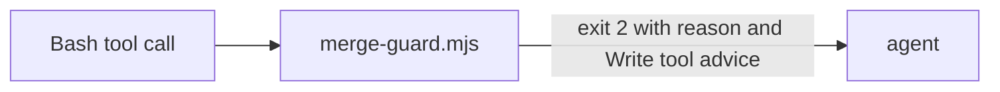

# Execution Plan - merge-guard block message

> Every requirement is traceable to a user story or acceptance criterion.

**Skill:** [plan](../skills/ravintio-plan/SKILL.md)
**Feature:** 0000197-merge-guard-block-message
**Version:** 0.20.1
**Status:** active

## Active Skills

| Skill | Scope | Purpose |
|-------|-------|---------|
| None | none | none |

## Functional Requirements Directory

Functional requirements are split into individual files, one user story per file, at `plan/current/requirements/`.

| File | Requirement |
|------|------------|
| [req-001-name-the-real-block-reason.md](requirements/req-001-name-the-real-block-reason.md) | Name the real block reason and advise the Write tool |

## Non-Functional Requirements

| ID | Category | Requirement | Target | Measurement |
|----|----------|------------|--------|-------------|
| NFR-001 | Security | The block set stays identical | Zero commands change exit code | The existing merge-guard suite passes apart from message-text tests |

## API Summary

No API. The hook reads a JSON payload on stdin and exits 0 or 2.

## Data Model Summary

No data model. No schema change.

## Component Interactions

## Assumptions

| ID | Assumption | Impact if Wrong |
|----|-----------|----------------|
| A-001 | Backlog line numbers are approximate | P2 locates each block by name |

## Open Questions

None.
