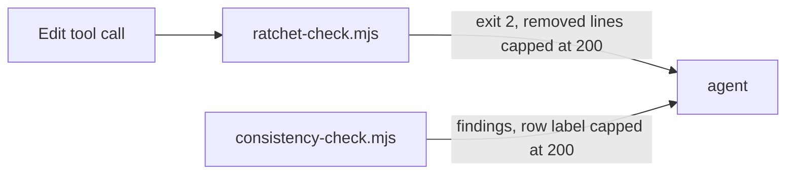

# Execution Plan - cap echoed plan text

> Every requirement is traceable to a user story or acceptance criterion.

**Skill:** [plan](../skills/ravintio-plan/SKILL.md)
**Feature:** 0000198-cap-echoed-plan-text
**Version:** 0.20.2
**Status:** active

## Active Skills

| Skill | Scope | Purpose |
|-------|-------|---------|
| None | none | none |

## Functional Requirements Directory

Functional requirements are split into individual files, one user story per file, at `plan/current/requirements/`.

| File | Requirement |
|------|------------|
| [req-001-cap-the-ratchet-block-message.md](requirements/req-001-cap-the-ratchet-block-message.md) | Cap each removed line in the ratchet block message |
| [req-002-cap-the-consistency-finding.md](requirements/req-002-cap-the-consistency-finding.md) | Cap the story map row label in consistency findings |

## Non-Functional Requirements

| ID | Category | Requirement | Target | Measurement |
|----|----------|------------|--------|-------------|
| NFR-001 | Security | The block set and the finding set stay identical | Zero writes or findings change exit code | The existing ratchet and consistency suites pass |
| NFR-002 | Security | An echoed line is bounded | At most 200 characters plus the cut marker | The new suite feeds a 1000-character line to each program |

## API Summary

No API. The hook reads a JSON payload on stdin and exits 0 or 2. The check reads a folder and exits 0 or 1.

## Data Model Summary

No data model. No schema change.

## Component Interactions

## Assumptions

| ID | Assumption | Impact if Wrong |
|----|-----------|----------------|
| A-001 | The cap counts the echoed line and excludes the marker | A test asserts a slightly different length, and P2 adjusts the test and the docs |

## Open Questions

None.
