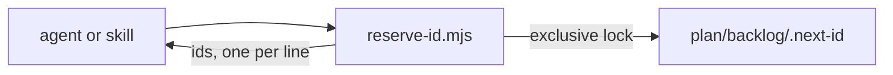

# Execution Plan - reserve ids from a counter

> Every requirement is traceable to a user story or acceptance criterion.

**Skill:** [plan](../skills/ravintio-plan/SKILL.md)
**Feature:** 0000199-reserve-ids-from-counter
**Version:** 0.21.0
**Status:** active

## Active Skills

| Skill | Scope | Purpose |
|-------|-------|---------|
| None | none | none |

## Functional Requirements Directory

Functional requirements are split into individual files, one user story per file, at `plan/current/requirements/`.

| File | Requirement |
|------|------------|
| [req-001-reserve-ids-with-a-script.md](requirements/req-001-reserve-ids-with-a-script.md) | Reserve a block of ids from the counter file under a lock |
| [req-002-bootstrap-and-seed-the-counter.md](requirements/req-002-bootstrap-and-seed-the-counter.md) | Bootstrap a repo with no counter, and seed this repo at 0000210 |
| [req-003-call-the-counter-from-every-id-rule.md](requirements/req-003-call-the-counter-from-every-id-rule.md) | Every id rule calls the script, and a copied entry names its source id |

## Non-Functional Requirements

| ID | Category | Requirement | Target | Measurement |
|----|----------|------------|--------|-------------|
| NFR-001 | Reliability | Reservations are atomic | Concurrent reservations return disjoint ranges and the file ends at the sum | A test starts 8 reservations at once |
| NFR-002 | Reliability | A failure leaves the counter unchanged | Zero bytes change on a held lock, a bad counter, or a bad quantity | Tests compare the file before and after |

## API Summary

No network API. The command is `node ravintio-zero/scripts/reserve-id.mjs [qty] [--file path] [--init]`. It prints one id per line and exits 0, or prints one line to stderr and exits 1.

## Data Model Summary

One file, `plan/backlog/.next-id`, holds one seven-digit number and a newline. No schema change.

## Component Interactions

## Assumptions

| ID | Assumption | Impact if Wrong |
|----|-----------|----------------|
| A-001 | A merge conflict on `.next-id` resolves by keeping the higher value | Two entries share an id until someone renumbers one |

## Open Questions

None.
