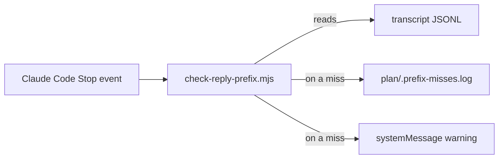

# Execution Plan - reply conventions

> Every requirement is traceable to a user story or acceptance criterion.

**Skill:** [plan](../skills/ravintio-plan/SKILL.md)
**Feature:** 0000200-reply-conventions
**Version:** 0.22.0
**Status:** active

## Active Skills

| Skill | Scope | Purpose |
|-------|-------|---------|
| None | none | none |

## Functional Requirements Directory

Functional requirements are split into individual files, one user story per file, at `plan/current/requirements/`.

| File | Requirement |
|------|------------|
| [req-001-prefix-table-and-reporting-rule.md](requirements/req-001-prefix-table-and-reporting-rule.md) | Prefix table, `Supervise:`, and the reporting rule in the boot file and orchestrator |
| [req-002-prefix-line-in-phase-skills.md](requirements/req-002-prefix-line-in-phase-skills.md) | Each phase skill restates its prefix |
| [req-003-stop-hook-warns-and-logs.md](requirements/req-003-stop-hook-warns-and-logs.md) | The Stop hook warns and logs a miss, and never blocks |
| [req-004-setup-wires-the-stop-hook.md](requirements/req-004-setup-wires-the-stop-hook.md) | Both setup scripts wire the same Stop entry |

## Non-Functional Requirements

| ID | Category | Requirement | Target | Measurement |
|----|----------|------------|--------|-------------|
| NFR-001 | Reliability | The hook never blocks a turn | Exit code 0 on every input | A test feeds a miss, a hit, no sentinel, a malformed payload, and a missing transcript |
| NFR-002 | Privacy | The log holds little reply text | At most 80 characters per line | A test checks the line length |

## API Summary

No network API. The hook reads a `Stop` payload on stdin and prints `{"systemMessage": "..."}` on a miss.

## Data Model Summary

One untracked file, `plan/.prefix-misses.log`, holds one line per miss. No schema change.

## Component Interactions

## Assumptions

| ID | Assumption | Impact if Wrong |
|----|-----------|----------------|
| A-001 | The Stop payload carries `transcript_path` to a JSONL transcript | The warning never fires |
| A-002 | The boot file reloads after compaction | The rule drops after compaction |

## Open Questions

None.
