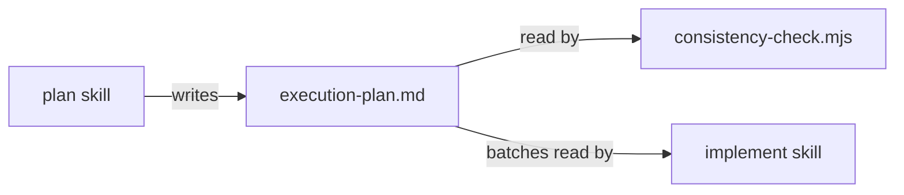

# Execution Plan - plan concurrent work

> Every requirement is traceable to a user story or acceptance criterion.

**Skill:** [plan](../skills/ravintio-plan/SKILL.md)
**Feature:** 0000201-plan-concurrent-work
**Version:** 0.23.0
**Status:** active

## Active Skills

| Skill | Scope | Purpose |
|-------|-------|---------|
| None | none | none |

## Functional Requirements Directory

Functional requirements are split into individual files, one user story per file, at `plan/current/requirements/`.

| File | Requirement |
|------|------------|
| [req-001-concurrency-section-in-plan.md](requirements/req-001-concurrency-section-in-plan.md) | Template, guide, plan skill, and re-run reference carry the Concurrency plan section |
| [req-002-concurrent-by-default.md](requirements/req-002-concurrent-by-default.md) | The dispatch standard and implement skill state the default and the reason rule |
| [req-003-consistency-check-concurrency.md](requirements/req-003-consistency-check-concurrency.md) | Check 8 validates the section |

## Non-Functional Requirements

| ID | Category | Requirement | Target | Measurement |
|----|----------|------------|--------|-------------|
| NFR-001 | Reliability | Check 8 adds no network call and no model call | Zero | Code review of the script imports |
| NFR-002 | Compatibility | A fixture with no `execution-plan.md` still passes the existing checks | Zero new findings | The 0000170 and 0000198 suites stay green |

## API Summary

No network API. The check prints findings on stdout and exits 1 on any finding.

## Data Model Summary

No datastore. The check reads `plan/current/execution-plan.md`. No schema change.

## Component Interactions

## Concurrency plan

Batch 1 holds three units that write disjoint files. Batch 2 holds the docs unit, which describes what batch 1 builds.

| Unit | Depends on | Writes | Batch | Sequential reason |
|------|------------|--------|-------|-------------------|
| U1-check-8 | none | `ravintio-zero/scripts/consistency-check.mjs`, `ravintio-zero/tests/test-0000201-req-003-concurrency-check.sh` | 1 | |
| U2-plan-docs | none | `ravintio-zero/templates/execution-plan.template.md`, `ravintio-zero/templates/execution-plan-guide.md`, `ravintio-zero/skills/ravintio-plan/SKILL.md`, `ravintio-zero/skills/ravintio-orchestrator/references/orchestrator-mid-pipeline-changes.md`, `ravintio-zero/tests/test-0000201-req-001-concurrency-section.sh` | 1 | |
| U3-dispatch-rule | none | `ravintio-zero/standards/agent-dispatch-standards.md`, `ravintio-zero/skills/ravintio-implement/SKILL.md`, `ravintio-zero/tests/test-0000201-req-002-concurrent-by-default.sh` | 1 | |
| U4-living-docs | U1-check-8, U2-plan-docs, U3-dispatch-rule | `ravintio-zero/component.yml`, `docs/architecture-overview.md` | 2 | Describes the finished behaviour of U1 to U3, so it reads their final wording. |

## Assumptions

| ID | Assumption | Impact if Wrong |
|----|-----------|----------------|
| A-001 | The plan skill is the only writer of `execution-plan.md` | A plan written elsewhere skips the section and the check fails it |
| A-002 | Existing consistency tests build fixtures without `execution-plan.md` | Check 8 breaks them |

## Open Questions

None.
