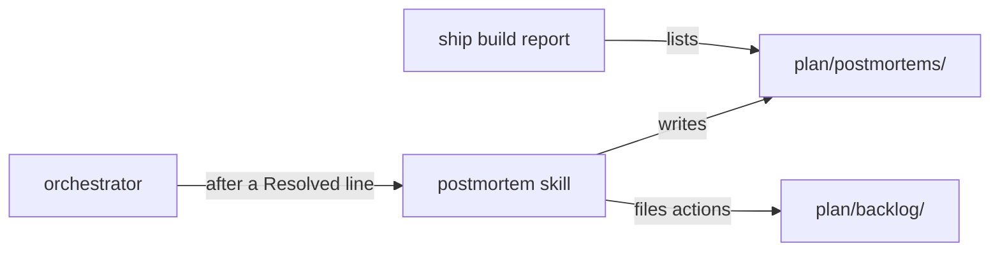

# Execution Plan - blameless postmortems

> Every requirement is traceable to a user story or acceptance criterion.

**Skill:** [plan](../skills/ravintio-plan/SKILL.md)
**Feature:** 0000203-blameless-postmortems
**Version:** 0.25.0
**Status:** active

## Active Skills

| Skill | Scope | Purpose |
|-------|-------|---------|
| None | none | none |

## Functional Requirements Directory

Functional requirements are split into individual files, one user story per file, at `plan/current/requirements/`.

| File | Requirement |
|------|------------|
| [req-001-postmortem-skill.md](requirements/req-001-postmortem-skill.md) | The ravintio-postmortem skill and its record template |
| [req-002-trigger-report-and-docs.md](requirements/req-002-trigger-report-and-docs.md) | The orchestrator trigger, the build report line, and the living docs |

## Non-Functional Requirements

| ID | Category | Requirement | Target | Measurement |
|----|----------|------------|--------|-------------|
| NFR-001 | Maintainability | The skill file stays short | Under 120 lines | A test counts the lines |

## API Summary

No network API.

## Data Model Summary

No datastore. No schema change. A record is one Markdown file at `plan/postmortems/{date}-{slug}.md`.

## Component Interactions

## Concurrency plan

Batch 1 holds two units that write disjoint files. Batch 2 holds the docs unit, which describes what batch 1 builds.

| Unit | Depends on | Writes | Batch | Sequential reason |
|------|------------|--------|-------|-------------------|
| U1-postmortem-skill | none | `ravintio-zero/skills/ravintio-postmortem/SKILL.md`, `ravintio-zero/templates/postmortem.template.md`, `ravintio-zero/tests/test-0000031-req-003-five-phases.sh`, `ravintio-zero/tests/test-0000203-req-001-postmortem-skill.sh` | 1 | |
| U2-trigger-and-report | none | `ravintio-zero/skills/ravintio-orchestrator/SKILL.md`, `ravintio-zero/skills/ravintio-orchestrator/references/orchestrator-skills-catalogue.md`, `ravintio-zero/skills/ravintio-ship/SKILL.md`, `ravintio-zero/tests/test-0000203-req-002-trigger-and-report.sh` | 1 | |
| U3-living-docs | U1-postmortem-skill, U2-trigger-and-report | `ravintio-zero/component.yml`, `docs/architecture-overview.md`, `ravintio-zero/pipeline-reference.md` | 2 | Describes the finished behaviour of U1 and U2, so it reads their final wording. |

## Assumptions

| ID | Assumption | Impact if Wrong |
|----|-----------|----------------|
| A-001 | The orchestrator can read `Blocked:` and `Resolved:` lines from the build log | The trigger never fires and the human requests a postmortem by hand |

## Open Questions

None.
