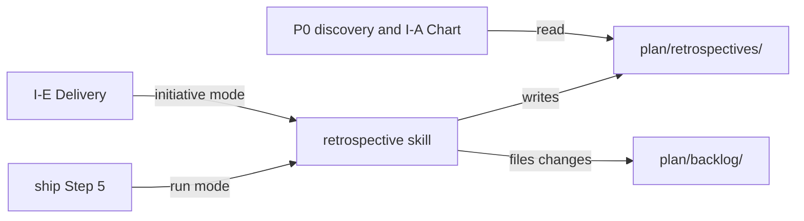

# Execution Plan - run and initiative retrospectives

> Every requirement is traceable to a user story or acceptance criterion.

**Skill:** [plan](../skills/ravintio-plan/SKILL.md)
**Feature:** 0000204-run-and-initiative-retrospectives
**Version:** 0.26.0
**Status:** active

## Active Skills

| Skill | Scope | Purpose |
|-------|-------|---------|
| None | none | none |

## Functional Requirements Directory

Functional requirements are split into individual files, one user story per file, at `plan/current/requirements/`.

| File | Requirement |
|------|------------|
| [req-001-retrospective-skill.md](requirements/req-001-retrospective-skill.md) | The ravintio-retrospective skill and its record template |
| [req-002-hooks-and-reads.md](requirements/req-002-hooks-and-reads.md) | The ship and delivery hooks, and the P0 and chart reads |
| [req-003-living-docs-and-counts.md](requirements/req-003-living-docs-and-counts.md) | The living docs and the skill count |

## Non-Functional Requirements

| ID | Category | Requirement | Target | Measurement |
|----|----------|------------|--------|-------------|
| NFR-001 | Maintainability | The skill file stays short | Under 120 lines | A test counts the lines |

## API Summary

No network API.

## Data Model Summary

No datastore. No schema change. A record is one Markdown file in `plan/retrospectives/`.

## Component Interactions

## Concurrency plan

Batch 1 holds two units that write disjoint files. Batch 2 holds the docs unit, which describes what batch 1 builds.

| Unit | Depends on | Writes | Batch | Sequential reason |
|------|------------|--------|-------|-------------------|
| U1-retrospective-skill | none | `ravintio-zero/skills/ravintio-retrospective/SKILL.md`, `ravintio-zero/templates/retrospective.template.md`, `ravintio-zero/tests/test-0000204-req-001-retrospective-skill.sh` | 1 | |
| U2-hooks-and-reads | none | `ravintio-zero/skills/ravintio-ship/SKILL.md`, `ravintio-zero/skills/ravintio-orchestrator/SKILL.md`, `ravintio-zero/skills/ravintio-orchestrator/references/orchestrator-skills-catalogue.md`, `ravintio-zero/standards/roadmap-standards.md`, `ravintio-zero/tests/test-0000204-req-002-hooks-and-reads.sh` | 1 | |
| U3-living-docs | U1-retrospective-skill, U2-hooks-and-reads | `ravintio-zero/component.yml`, `docs/architecture-overview.md`, `ravintio-zero/pipeline-reference.md`, `ravintio-zero/tests/test-0000031-req-003-five-phases.sh`, `ravintio-zero/tests/test-0000031-req-004-setup-execution.sh`, `ravintio-zero/tests/test-0000160-req-001-pack-identifiers.sh`, `ravintio-zero/tests/test-0000204-req-003-living-docs.sh` | 2 | Describes the finished behaviour of U1 and U2, so it reads their final wording. |

## Assumptions

| ID | Assumption | Impact if Wrong |
|----|-----------|----------------|
| A-001 | The ship step can read the archived build log, the postmortems, and the `Rework:` lines | The retrospective omits evidence and the human requests a rerun |
| A-002 | I-E Delivery can read `initiative.md` and every step tag | The charted-versus-shipped comparison has gaps and the record says so |

## Open Questions

None.
