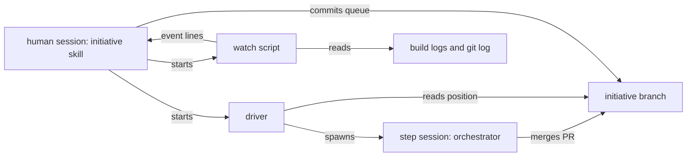

# Execution Plan - initiative skill

> Every requirement is traceable to a user story or acceptance criterion.

**Skill:** [plan](../skills/ravintio-plan/SKILL.md)
**Feature:** 0000205-initiative-skill
**Version:** 0.27.0
**Status:** active

## Active Skills

| Skill | Scope | Purpose |
|-------|-------|---------|
| None | none | none |

## Functional Requirements Directory

Functional requirements are split into individual files, one user story per file, at `plan/current/requirements/`.

| File | Requirement |
|------|------------|
| [req-001-driver-fixes.md](requirements/req-001-driver-fixes.md) | Driver fixes |
| [req-002-ack-and-trigger-hooks.md](requirements/req-002-ack-and-trigger-hooks.md) | The ack split and the trigger hooks |
| [req-003-watch-script.md](requirements/req-003-watch-script.md) | The read-only watch script |
| [req-004-initiative-skill.md](requirements/req-004-initiative-skill.md) | The initiative skill and the resume split |
| [req-005-living-docs-and-counts.md](requirements/req-005-living-docs-and-counts.md) | The living docs and the skill count |
| [req-006-driver-final-report.md](requirements/req-006-driver-final-report.md) | The driver final report |
| [req-007-stage-ownership.md](requirements/req-007-stage-ownership.md) | One owner for each stage |

## Non-Functional Requirements

| ID | Category | Requirement | Target | Measurement |
|----|----------|------------|--------|-------------|
| NFR-001 | Maintainability | The skill file stays short | Under 120 lines | A test counts the lines |
| NFR-002 | Observability | The watch script reports often enough | A heartbeat every 300 seconds | A test reads the interval constant |

## API Summary

No network API.

## Data Model Summary

No datastore. No schema change. The queue is a folder of backlog entry files.

## Component Interactions

## Concurrency plan

Batch 1 holds three units that write disjoint files. Batch 2 holds the skill, which names the watch script and the hook behaviour. Batch 3 holds the docs, which describe the finished behaviour and share `roadmap-standards.md` with batch 2.

| Unit | Depends on | Writes | Batch | Sequential reason |
|------|------------|--------|-------|-------------------|
| U1-driver | none | `ravintio-zero/scripts/initiative-run.mjs`, `ravintio-zero/tests/test-0000205-req-001-driver-fixes.sh`, `ravintio-zero/tests/test-0000205-req-006-driver-final-report.sh` | 1 | |
| U2-hooks | none | `ravintio-zero/hooks/enforcement/auto-trigger-orchestrator.mjs`, `ravintio-zero/hooks/enforcement/check-orchestrator-presence.mjs`, `ravintio-zero/tests/test-0000205-req-002-ack-and-trigger-hooks.sh` | 1 | |
| U3-watch | none | `ravintio-zero/scripts/initiative-watch.mjs`, `ravintio-zero/tests/test-0000205-req-003-watch-script.sh` | 1 | |
| U4-skill | U3-watch | `ravintio-zero/skills/ravintio-initiative/SKILL.md`, `ravintio-zero/skills/ravintio-orchestrator/SKILL.md`, `ravintio-zero/standards/roadmap-standards.md`, `ravintio-zero/tests/test-0000205-req-004-initiative-skill.sh`, `ravintio-zero/tests/test-0000205-req-007-stage-ownership.sh` | 2 | Names the watch script and the ack behaviour of U2 and U3, so it reads their final wording. |
| U5-living-docs | U4-skill | `ravintio-zero/project-operations.md`, `ravintio-zero/component.yml`, `docs/architecture-overview.md`, `ravintio-zero/pipeline-reference.md`, `ravintio-zero/skills/ravintio-orchestrator/references/orchestrator-skills-catalogue.md`, `ravintio-zero/tests/test-0000031-req-003-five-phases.sh`, `ravintio-zero/tests/test-0000031-req-004-setup-execution.sh`, `ravintio-zero/tests/test-0000160-req-001-pack-identifiers.sh`, `ravintio-zero/tests/test-0000204-req-003-living-docs.sh`, `ravintio-zero/tests/test-0000203-req-002-trigger-and-report.sh`, `ravintio-zero/tests/test-0000205-req-005-living-docs-and-counts.sh` | 3 | Describes the finished behaviour of U4 and shares the standards file's topic. |

## Assumptions

| ID | Assumption | Impact if Wrong |
|----|-----------|----------------|
| A-001 | A step merges its feature PR into the initiative branch before the driver reads `position` | The driver stops with a not-merged line and the human restarts it |
| A-002 | The host offers a background monitor tool | The skill reports on each prompt and at phase ends only |

## Open Questions

None.
