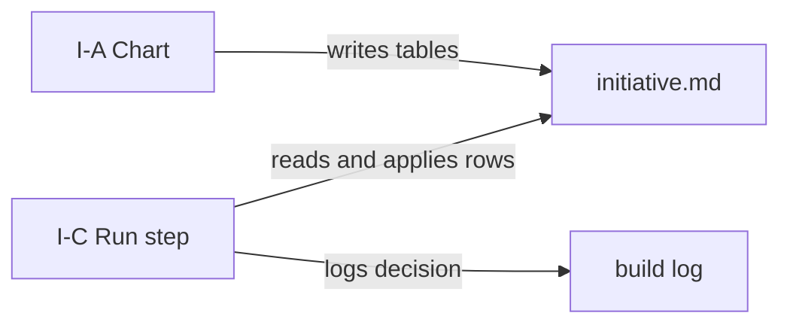

# Execution Plan - chart-time decisions

> Every requirement is traceable to a user story or acceptance criterion.

**Skill:** [plan](../skills/ravintio-plan/SKILL.md)
**Feature:** 0000206-chart-time-decisions
**Version:** 0.28.0
**Status:** active

## Active Skills

| Skill | Scope | Purpose |
|-------|-------|---------|
| None | none | none |

## Functional Requirements Directory

Functional requirements are split into individual files, one user story per file, at `plan/current/requirements/`.

| File | Requirement |
|------|------------|
| [req-001-chart-rules-and-template.md](requirements/req-001-chart-rules-and-template.md) | The Chart-time decisions rules and the template tables |
| [req-002-step-application.md](requirements/req-002-step-application.md) | Step-side application and skill pointers |
| [req-003-worked-example.md](requirements/req-003-worked-example.md) | The worked example replaying roadmap 0000168 |

## Non-Functional Requirements

| ID | Category | Requirement | Target | Measurement |
|----|----------|------------|--------|-------------|
| NFR-001 | Maintainability | The skill text total stays within budget | At most 1720 lines | The five-phases test counts the lines |

## API Summary

No network API.

## Data Model Summary

No datastore. No schema change.

## Component Interactions

## Concurrency plan

Unit U1 writes the standards file and the template. Unit U2 reads U1's final wording in the I-C Run section of the same standards file, so it runs after U1.

| Unit | Depends on | Writes | Batch | Sequential reason |
|------|------------|--------|-------|-------------------|
| U1-chart-rules | none | `ravintio-zero/standards/roadmap-standards.md`, `ravintio-zero/templates/initiative.template.md`, `ravintio-zero/tests/test-0000206-req-001-chart-rules.sh` | 1 | Starts the chain and holds the standards file that U2 edits next. |
| U2-step-application | U1-chart-rules | `ravintio-zero/standards/roadmap-standards.md`, `ravintio-zero/skills/ravintio-initiative/SKILL.md`, `ravintio-zero/skills/ravintio-orchestrator/SKILL.md`, `ravintio-zero/tests/test-0000206-req-002-step-application.sh` | 2 | Edits the same standards file as U1 and reads its final wording. |

## Assumptions

| ID | Assumption | Impact if Wrong |
|----|-----------|----------------|
| A-001 | Step sessions read `initiative.md` | A step cannot apply a row and stops, as today |

## Open Questions

None.
