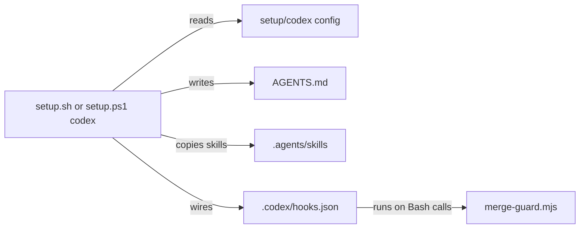

# Execution Plan - Codex support

> Every requirement is traceable to a user story or acceptance criterion.

**Skill:** [plan](../skills/ravintio-plan/SKILL.md)
**Feature:** 0000207-codex-support
**Version:** 0.29.0
**Status:** active

## Active Skills

| Skill | Scope | Purpose |
|-------|-------|---------|
| None | none | none |

## Functional Requirements Directory

Functional requirements are split into individual files, one user story per file, at `plan/current/requirements/`.

| File | Requirement |
|------|------------|
| [req-001-codex-tool-target.md](requirements/req-001-codex-tool-target.md) | The `codex` tool target in both setup scripts and the refresh skill |
| [req-002-boot-file-and-skills.md](requirements/req-002-boot-file-and-skills.md) | The `AGENTS.md` boot file and skills in `.agents/skills` |
| [req-003-hook-mapping-and-report.md](requirements/req-003-hook-mapping-and-report.md) | The `merge-guard` hook and the active and fallback report |
| [req-004-codex-ci-check.md](requirements/req-004-codex-ci-check.md) | The CI step and test for the `codex` target |

## Non-Functional Requirements

| ID | Category | Requirement | Target | Measurement |
|----|----------|------------|--------|-------------|
| NFR-001 | Compatibility | The Claude Code install stays unchanged | Zero changed files in a Claude Code install | A test installs for `claude-code` and checks the files |
| NFR-002 | Maintainability | The skill text total stays within budget | At most 1720 lines | The five-phases test counts the lines |

## API Summary

No network API.

## Data Model Summary

No datastore. No schema change.

## Component Interactions

## Concurrency plan

Unit U1 builds the Bash path and the boot template. Unit U2 builds the PowerShell path and reads the boot template from U1. Unit U3 edits the skill, CI files, and docs, which no other unit writes.

| Unit | Depends on | Writes | Batch | Sequential reason |
|------|------------|--------|-------|-------------------|
| U1-sh-target | none | `ravintio-zero/setup.sh`, `ravintio-zero/setup/codex.sh`, `ravintio-zero/templates/codex-boot.md`, `ravintio-zero/tests/test-0000207-req-001-003-codex-setup.sh` | 1 | Starts the chain and writes the boot template that U2 reads. |
| U2-ps1-target | U1-sh-target | `ravintio-zero/setup.ps1`, `ravintio-zero/setup/codex.ps1`, `ravintio-zero/tests/test-0000207-req-001-003-codex-setup.ps1` | 2 | Reads the final boot template from U1. |
| U3-skill-ci-docs | none | `ravintio-zero/skills/ravintio-refresh-setup/SKILL.md`, `.github/workflows/ravintio.yml`, `ravintio-zero/hooks/ravintio.yml`, `ravintio-zero/tests/test-0000207-req-004-codex-ci-check.sh`, `README.md`, `ravintio-zero/getting-started.md` | 2 | none |

## Assumptions

| ID | Assumption | Impact if Wrong |
|----|-----------|----------------|
| A-001 | `.codex/hooks.json` follows the shape in the Codex docs | Codex ignores the file and `AGENTS.md` still states the rule |

## Open Questions

None.
