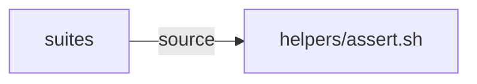

# Execution Plan - test suite reliability

> Every requirement must be traceable to a user story or acceptance criterion.

**Skill:** [plan](../../ravintio-zero/skills/ravintio-plan/SKILL.md)
**Feature:** 0000239-test-suite-reliability
**Version:** 0.30.2
**Status:** active

## Active Skills

None.

## Functional Requirements Directory

| File | Requirement |
|------|------------|
| [req-001-undefined-assert-fails.md](requirements/req-001-undefined-assert-fails.md) | Undefined assert fails the suite, and `assert_not_contains` exists |
| [req-002-stale-install-skip.md](requirements/req-002-stale-install-skip.md) | Stale install skip in an active initiative |

## Non-Functional Requirements

| ID | Category | Requirement | Target | Measurement |
|----|----------|------------|--------|-------------|
| NFR-001 | Compatibility | Helpers run on macOS Bash 3.2 | 0 syntax errors | The new suite runs on the dev machine |

## API Summary

No API.

## Data Model Summary

No data.

## Component Interactions

## Concurrency plan

| Unit | Depends on | Writes | Batch | Sequential reason |
|------|-----------|--------|-------|-------------------|
| req-001 | none | ravintio-zero/tests/helpers/assert.sh, ravintio-zero/tests/test-0000239-req-001-undefined-assert-fails.sh | 1 | Both units edit assert.sh |
| req-002 | req-001 | ravintio-zero/tests/helpers/assert.sh, ravintio-zero/tests/test-0000239-req-002-stale-install-skip.sh, ravintio-zero/tests/test-0000151-req-014-chart-clarity-and-dependency-stop.sh | 2 | Shares assert.sh with req-001 |

## Assumptions

| ID | Assumption | Impact if Wrong |
|----|-----------|----------------|
| A-001 | Suites call assert helpers at the start of a line | A call in another position passes unseen |

## Open Questions

None.
