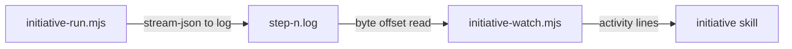

# Execution Plan - stream step session activity

> Every requirement traces to a user story or acceptance criterion.

**Skill:** [plan](../skills/ravintio-plan/SKILL.md)
**Feature:** 0000240-stream-step-session-activity
**Version:** 0.31.0
**Status:** active

## Active Skills

None.

## Functional Requirements Directory

| File | Requirement |
|------|------------|
| [req-001-driver-stream-args.md](requirements/req-001-driver-stream-args.md) | Driver starts steps with stream-json |
| [req-002-activity-summary-order.md](requirements/req-002-activity-summary-order.md) | Watcher prints one summary line per event |
| [req-003-activity-line-cap.md](requirements/req-003-activity-line-cap.md) | Activity lines stay within 200 characters |
| [req-004-driver-prints-no-content.md](requirements/req-004-driver-prints-no-content.md) | Driver prints no step content |
| [req-005-skill-relay-and-docs.md](requirements/req-005-skill-relay-and-docs.md) | Skill relays activity lines and standards describe them |

## Non-Functional Requirements

| ID | Category | Requirement | Target | Measurement |
|----|----------|------------|--------|-------------|
| NFR-001 | Performance | An event reaches the human's chat | 30 seconds or fewer, from a 10 second poll | `POLL_MS` equals 10000 |
| NFR-002 | Readability | Activity line length | 200 characters or fewer | Test on a 1,000 character input |
| NFR-003 | Security | Driver prints no step content and the log keeps mode 600 | zero marker strings in driver output | Stub binary test |

## API Summary

Not applicable. No endpoints.

## Data Model Summary

Not applicable. No datasets. The step log is a file the driver owns.

## Component Interactions

## Concurrency plan

U-001 is the driver (REQ-001, REQ-004). U-002 is the watcher (REQ-002, REQ-003). U-003 is the skill and docs (REQ-005).

| Unit | Depends on | Writes | Batch | Sequential reason |
|------|-----------|--------|-------|-------------------|
| U-001 | none | `ravintio-zero/scripts/initiative-run.mjs`, driver tests | 1 | none |
| U-002 | none | `ravintio-zero/scripts/initiative-watch.mjs`, watcher tests | 1 | none |
| U-003 | U-001, U-002 | `ravintio-zero/skills/ravintio-initiative/SKILL.md`, `ravintio-zero/standards/roadmap-standards.md`, docs | 2 | The text names the final line format |

## Assumptions

| ID | Assumption | Impact if Wrong |
|----|-----------|----------------|
| A-001 | stream-json emits one JSON object per line with `tool_use` items | The reader prints nothing for that shape |
| A-002 | The subagent tool is named `Task` or `Agent` | A subagent start prints as a `tool:` line |

## Open Questions

None.
