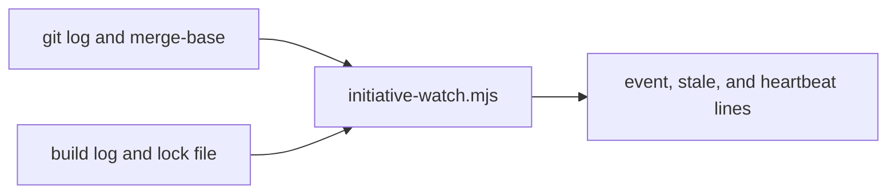

# Execution Plan - watcher false events

> Every requirement traces to a user story or acceptance criterion.

**Skill:** [plan](../skills/ravintio-plan/SKILL.md)
**Feature:** 0000241-watcher-false-events
**Version:** 0.31.1
**Status:** active

## Active Skills

None.

## Functional Requirements Directory

| File | Requirement |
|------|------------|
| [req-001-stale-threshold.md](requirements/req-001-stale-threshold.md) | A stale line needs a commit 15 minutes newer than the log |
| [req-002-stale-once.md](requirements/req-002-stale-once.md) | Each stale state prints once |
| [req-003-branch-change.md](requirements/req-003-branch-change.md) | A branch switch prints one line |
| [req-004-lock-state.md](requirements/req-004-lock-state.md) | The heartbeat reports the real lock state |

## Non-Functional Requirements

| ID | Category | Requirement | Target | Measurement |
|----|----------|------------|--------|-------------|
| NFR-001 | Noise | Stale lines per stale state | 1 | Test with `--once --passes 3` |
| NFR-002 | Noise | Lines for a branch switch with 100 unseen commits | 1 | Test with a 100-commit fixture |
| NFR-003 | Security | The watcher writes no file and uses fixed git argument arrays | zero files written | Existing watch script test |

## API Summary

Not applicable. No endpoints.

## Data Model Summary

Not applicable. No datasets. State stays in memory.

## Component Interactions

## Concurrency plan

U-001 is the watcher change (REQ-001 to REQ-004). U-002 is the docs.

| Unit | Depends on | Writes | Batch | Sequential reason |
|------|-----------|--------|-------|-------------------|
| U-001 | none | `ravintio-zero/scripts/initiative-watch.mjs`, watcher tests | 1 | One file holds every change |
| U-002 | U-001 | `ravintio-zero/standards/roadmap-standards.md`, docs | 2 | The text names the final line formats |

## Assumptions

| ID | Assumption | Impact if Wrong |
|----|-----------|----------------|
| A-001 | The heartbeat already reads the lock file on each pass | The lock test fails and the fix goes in this step |

## Open Questions

None.
