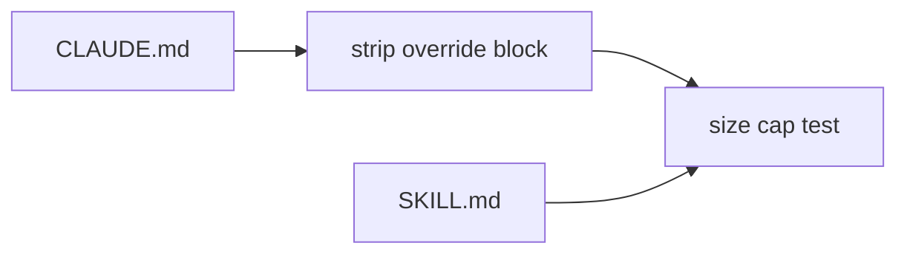

# Execution Plan - size cap excludes overrides

> Every requirement traces to a user story or acceptance criterion.

**Skill:** [plan](../skills/ravintio-plan/SKILL.md)
**Feature:** 0000242-size-cap-excludes-overrides
**Version:** 0.31.2
**Status:** active

## Active Skills

None.

## Functional Requirements Directory

| File | Requirement |
|------|------------|
| [req-001-pack-only-measure.md](requirements/req-001-pack-only-measure.md) | The size cap measure excludes the override block |
| [req-002-pack-only-cap.md](requirements/req-002-pack-only-cap.md) | The combined cap is the pack-only figure |

## Non-Functional Requirements

| ID | Category | Requirement | Target | Measurement |
|----|----------|------------|--------|-------------|
| NFR-001 | Determinism | Override bytes that change the size cap result | 0 | Test with a 5,000 byte appended block |

## API Summary

Not applicable. No endpoints.

## Data Model Summary

Not applicable. No datasets.

## Component Interactions

## Concurrency plan

U-001 is the test change (REQ-001 and REQ-002). U-002 is the docs.

| Unit | Depends on | Writes | Batch | Sequential reason |
|------|-----------|--------|-------|-------------------|
| U-001 | none | `ravintio-zero/tests/test-0000151-req-011-orchestrator-references-split.sh` | 1 | One file holds every change |
| U-002 | U-001 | docs that name the cap | 2 | The text names the final cap |

## Assumptions

| ID | Assumption | Impact if Wrong |
|----|-----------|----------------|
| A-001 | `CLAUDE.md` outside the markers equals `standard-boot.md` | The measure differs by a few bytes and the margin absorbs it |

## Open Questions

None.
