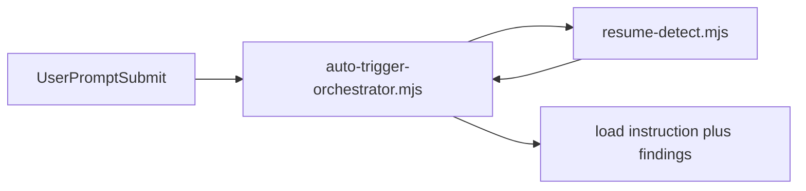

# Execution Plan - session start detection

> Every requirement traces to a user story or acceptance criterion.

**Skill:** [plan](../skills/ravintio-plan/SKILL.md)
**Feature:** 0000243-session-start-detection
**Version:** 0.32.0
**Status:** active

## Active Skills

None.

## Functional Requirements Directory

| File | Requirement |
|------|------------|
| [req-001-signal-lines.md](requirements/req-001-signal-lines.md) | The script prints one fixed line per resume signal |
| [req-002-fixed-text-only.md](requirements/req-002-fixed-text-only.md) | The script prints fixed text only |
| [req-003-hook-injection.md](requirements/req-003-hook-injection.md) | The hook injects the findings or a failure line |
| [req-004-initiative-findings.md](requirements/req-004-initiative-findings.md) | Step and initiative sessions get the same findings |
| [req-005-short-rule.md](requirements/req-005-short-rule.md) | Resume Detection is a short rule with a reference |
| [req-006-check-order.md](requirements/req-006-check-order.md) | Findings print in check order |

## Non-Functional Requirements

| ID | Category | Requirement | Target | Measurement |
|----|----------|------------|--------|-------------|
| NFR-001 | Safety | Characters of repo file text in the output | 0 | Fixture with planted text |
| NFR-002 | Latency | Script run time on a fixture | 2 seconds or fewer | Hook timeout, tested |

## API Summary

Not applicable. No endpoints.

## Data Model Summary

Not applicable. No datasets.

## Component Interactions

## Concurrency plan

U-001 is the script and its tests (REQ-001, REQ-002, REQ-006). U-002 is the hook and the initiative skill (REQ-003, REQ-004). U-003 is the reference and short rule (REQ-005).

| Unit | Depends on | Writes | Batch | Sequential reason |
|------|-----------|--------|-------|-------------------|
| U-001 | none | `ravintio-zero/scripts/resume-detect.mjs`, `ravintio-zero/tests/test-0000243-req-001-002-006-resume-detect.sh` | 1 | |
| U-003 | none | `ravintio-zero/skills/ravintio-orchestrator/SKILL.md`, `references/orchestrator-resume-detection.md`, `ravintio-zero/tests/test-0000243-req-005-short-rule.sh` | 1 | |
| U-002 | U-001 | `ravintio-zero/hooks/enforcement/auto-trigger-orchestrator.mjs`, `ravintio-zero/skills/ravintio-initiative/SKILL.md`, `ravintio-zero/tests/test-0000243-req-003-004-hook-injection.sh` | 2 | The hook runs the script |

## Assumptions

| ID | Assumption | Impact if Wrong |
|----|-----------|----------------|
| A-001 | The 12 checks stay the source of the order | The order test fails and shows it |

## Open Questions

None.
