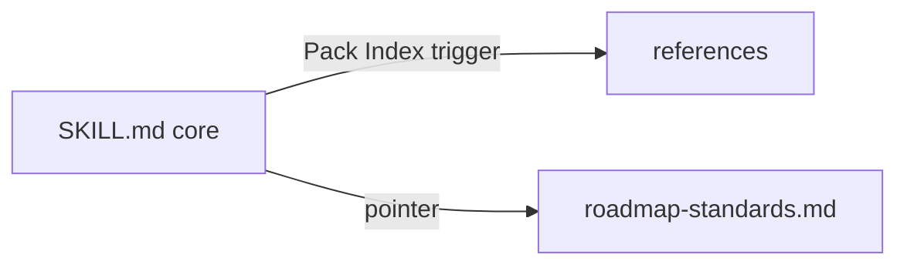

# Execution Plan - split the orchestrator skill

> Every requirement must be traceable to a user story or acceptance criterion.

**Skill:** [plan](../skills/ravintio-plan/SKILL.md)
**Feature:** 0000244-split-orchestrator-skill
**Version:** 0.33.0
**Status:** active

## Active Skills

| Skill | Scope | Purpose |
|-------|-------|---------|
| none | none | none |

## Functional Requirements Directory

Functional requirements are split into individual files, one user story per file, at `plan/current/requirements/`.

| File | Requirement |
|------|------------|
| [req-001-move-task-bound-sections.md](requirements/req-001-move-task-bound-sections.md) | Six task-bound sections live in reference files |
| [req-002-move-initiative-prefixes.md](requirements/req-002-move-initiative-prefixes.md) | Initiative prefixes live in the roadmap standards |
| [req-003-pack-index-rows.md](requirements/req-003-pack-index-rows.md) | Pack Index names a trigger for every reference file |
| [req-004-update-tests.md](requirements/req-004-update-tests.md) | Tests read the new locations |

## Non-Functional Requirements

| ID | Category | Requirement | Target | Measurement |
|----|----------|------------|--------|-------------|
| NFR-001 | Size | Orchestrator `SKILL.md` size | 9,000 bytes or fewer | `wc -c` in the size test |
| NFR-002 | Fidelity | No rule line lost | 0 missing base lines | No-lost-line check |

## API Summary

Not applicable. The feature builds no API.

## Data Model Summary

Not applicable. The feature holds no data.

## Component Interactions

## Concurrency plan

| Unit | Depends on | Writes | Batch | Sequential reason |
|------|-----------|--------|-------|-------------------|
| move-sections | none | ravintio-zero/skills/ravintio-orchestrator/SKILL.md, ravintio-zero/skills/ravintio-orchestrator/references/ | 1 | SKILL.md is the shared write target |
| move-prefixes | move-sections | ravintio-zero/standards/roadmap-standards.md, ravintio-zero/skills/ravintio-orchestrator/SKILL.md | 2 | Writes SKILL.md after the sections move |
| index-rows | move-prefixes | ravintio-zero/skills/ravintio-orchestrator/SKILL.md | 3 | Writes SKILL.md after the prefix move |
| update-tests | index-rows | ravintio-zero/tests/ | 4 | Tests need the final layout |

## Assumptions

| ID | Assumption | Impact if Wrong |
|----|-----------|----------------|
| A-001 | Each moved section is read only at its trigger | A session misses a rule until it reads the reference |

## Open Questions

None.
