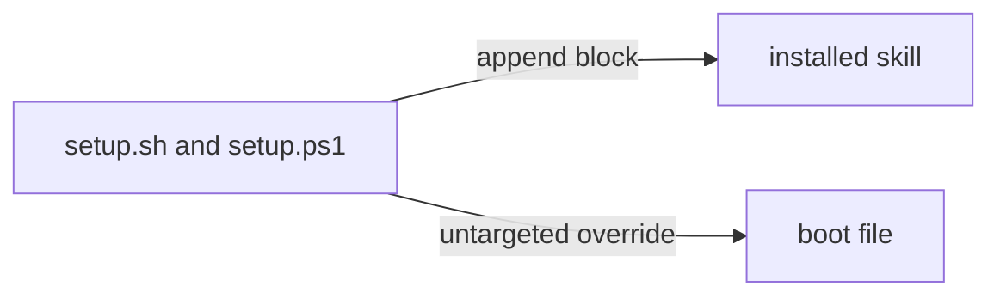

# Execution Plan - boot rules into skills

> Every requirement must be traceable to a user story or acceptance criterion.

**Skill:** [plan](../skills/ravintio-plan/SKILL.md)
**Feature:** 0000245-boot-rules-into-skills
**Version:** 0.34.0
**Status:** active

## Active Skills

None.

## Functional Requirements Directory

| File | Requirement |
|------|------------|
| [req-001-hook-enforcement-reference.md](requirements/req-001-hook-enforcement-reference.md) | Hook rules move to a reference file |
| [req-002-targeted-overrides.md](requirements/req-002-targeted-overrides.md) | Setup appends a targeted override to its skill |
| [req-003-repo-skills.md](requirements/req-003-repo-skills.md) | GUTD and branch cleanup become repo skills |
| [req-004-size-cap-tests.md](requirements/req-004-size-cap-tests.md) | A test caps the generated boot file |

## Non-Functional Requirements

| ID | Category | Requirement | Target | Measurement |
|----|----------|------------|--------|-------------|
| NFR-001 | Size | Generated `CLAUDE.md` with every override | 6,000 bytes or fewer | `wc -c` in the REQ-004 test |
| NFR-002 | Security | Override `target:` value | Matches `^[a-z0-9][a-z0-9-]*$` and names an installed skill | Traversal fixture in the REQ-002 test |

## API Summary

None. The feature builds no API.

## Data Model Summary

None. The feature owns no data.

## Component Interactions

## Concurrency plan

| Unit | Depends on | Writes | Batch | Sequential reason |
|------|-----------|--------|-------|-------------------|
| U-001 | none | `ravintio-zero/standards/hook-enforcement.md`, boot templates, hook messages | 1 | none |
| U-002 | none | `ravintio-zero/setup.sh`, `ravintio-zero/setup.ps1` | 1 | none |
| U-003 | U-002 | `ravintio-overrides/` | 2 | The skills use the target field that U-002 defines |
| U-004 | U-001, U-002, U-003 | `ravintio-zero/tests/` | 3 | The cap measures all three earlier changes |

## Assumptions

| ID | Assumption | Impact if Wrong |
|----|-----------|----------------|
| A-001 | A pack skill installs as `{skills dir}/{name}/SKILL.md` | Setup falls back to the boot file |
| A-002 | 0000242 already set the pack-only cap | The cap needs a second edit |

## Open Questions

None.
