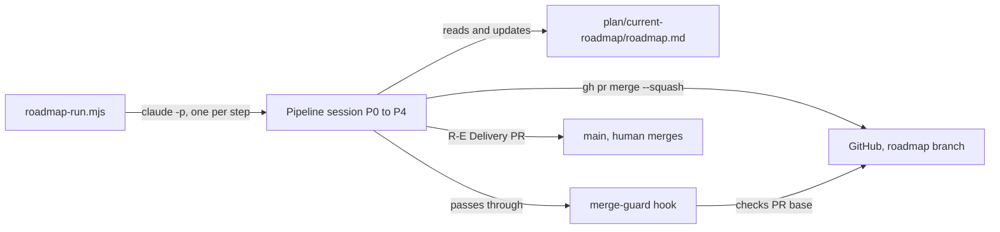

# Execution Plan - autonomous-roadmaps

> Every requirement must be traceable to a user story or acceptance criterion.

**Skill:** [plan](../../planifest-zero/skills/planifest-plan/SKILL.md)
**Feature:** 0000043-autonomous-roadmaps
**Version:** 0.10.0
**Status:** active

## Active Skills

| Skill | Scope | Purpose |
|-------|-------|---------|
| None | | No capability skill applies |

## Decisions referenced

| ADR | Decision |
|-----|----------|
| ADR-001 | Stack unchanged: Markdown skills, Node ESM scripts and hooks, Bash and PowerShell setup |
| ADR-002 | Roadmap storage and lifecycle: `plan/roadmap/` for drafts, `plan/current-roadmap/` for the active roadmap |
| ADR-003 | The agent squash-merges step PRs into roadmap branches only |
| ADR-004 | The driver script starts a fresh session for each step |
| ADR-005 | The agent tags the squash commit after the merge |
| ADR-006 | Roadmap steps self-confirm at P0, and stages use the `R-A` to `R-E` prefixes |

## Functional Requirements Directory

Each file follows the naming convention `req-{NNN}-{kebab-slug}.md` and the [Requirement Template](../../planifest-zero/templates/requirement.template.md).

| File | Requirement | Source |
|------|------------|--------|
| [req-001-roadmap-drafts.md](requirements/req-001-roadmap-drafts.md) | Draft roadmaps, the template, and shared ids | US-001 |
| [req-002-roadmap-chart.md](requirements/req-002-roadmap-chart.md) | R-A Chart from an idea or a draft | US-002 |
| [req-003-roadmap-activate.md](requirements/req-003-roadmap-activate.md) | R-B Activate: branch, state, and driver offer | US-003 |
| [req-004-roadmap-step-discovery.md](requirements/req-004-roadmap-step-discovery.md) | Self-confirmed P0 and per-step bump | US-004 |
| [req-005-roadmap-advance.md](requirements/req-005-roadmap-advance.md) | R-D Advance: PR base, squash merge, tag | US-005 |
| [req-006-merge-guard-hook.md](requirements/req-006-merge-guard-hook.md) | merge-guard hook and its registration | US-008 |
| [req-007-roadmap-driver.md](requirements/req-007-roadmap-driver.md) | `roadmap-run.mjs` with lock and stop rules | US-007 |
| [req-008-roadmap-delivery.md](requirements/req-008-roadmap-delivery.md) | R-E Delivery: archive and roadmap PR | US-006 |
| [req-009-roadmap-resume-and-prefixes.md](requirements/req-009-roadmap-resume-and-prefixes.md) | Resume detection and the `R-A` to `R-E` prefixes | US-004, US-007 |
| [req-010-merge-carve-out-governance.md](requirements/req-010-merge-carve-out-governance.md) | Merge carve-out text in the orchestrator, ship skill, and overrides | US-008, US-005 |

## Requirement index

Paths are relative to the repo root. `ORCH` is `planifest-zero/skills/planifest-orchestrator/SKILL.md`, `SHIP` is `planifest-zero/skills/planifest-ship/SKILL.md`, and `REF` is `planifest-zero/pipeline-reference.md`. The `.claude/skills/` copies refresh through setup and nobody edits them by hand.

| Req | Slug | Source | Files in reach | New test file |
|-----|------|--------|----------------|---------------|
| req-001 | roadmap-drafts | US-001 | `roadmap-entry.template.md` (new), ORCH, `backlog-entry.template.md` (check), REF (check) | `planifest-zero/tests/test-0000043-req-001-roadmap-drafts.sh` |
| req-002 | roadmap-chart | US-002 | ORCH, `roadmap-entry.template.md`, REF | `planifest-zero/tests/test-0000043-req-002-roadmap-chart.sh` |
| req-003 | roadmap-activate | US-003 | ORCH, `planifest-zero/templates/` | `planifest-zero/tests/test-0000043-req-003-roadmap-activate.sh` |
| req-004 | roadmap-step-discovery | US-004 | ORCH (Discovery Start Actions 2, 10, 12, Scope Lock Challenge, Design Confirmation), `build-log.template.md` (check), REF (check) | `planifest-zero/tests/test-0000043-req-004-roadmap-step-discovery.sh` |
| req-005 | roadmap-advance | US-005 | SHIP (Hard Limits 4 and 5, Steps 6 to 8, Step 10), REF (Ship Phase) | `planifest-zero/tests/test-0000043-req-005-roadmap-advance.sh` |
| req-006 | merge-guard-hook | US-008 | `planifest-zero/hooks/enforcement/merge-guard.mjs` (new), `planifest-zero/setup.sh`, `planifest-zero/setup.ps1`, hook parity suite | `planifest-zero/tests/test-0000043-req-006-merge-guard-hook.sh` |
| req-007 | roadmap-driver | US-007 | `planifest-zero/scripts/roadmap-run.mjs` (new) | `planifest-zero/tests/test-0000043-req-007-roadmap-driver.sh` |
| req-008 | roadmap-delivery | US-006 | SHIP (Hard Limit 5, Steps 4 and 8), REF (Ship Phase) | `planifest-zero/tests/test-0000043-req-008-roadmap-delivery.sh` |
| req-009 | roadmap-resume-and-prefixes | US-004, US-007 | ORCH (Resume Detection, Phases and Response Prefixes, Hard Limit 10), REF (Phase Indicators) | `planifest-zero/tests/test-0000043-req-009-roadmap-resume-and-prefixes.sh` |
| req-010 | merge-carve-out-governance | US-008, US-005 | ORCH (merge rule), SHIP (Hard Limit 5), `planifest-overrides/instructions/custom-001-local-git-only.md`, `custom-004-ship-push-and-raise-pr.md`, `CLAUDE.md` (regenerated by setup) | `planifest-zero/tests/test-0000043-req-010-merge-carve-out-governance.sh` |

The existing guards `test-0000042-req-004`, `test-0000042-req-005`, and `test-0000042-req-006` run unchanged and must still pass.

## Implementation order

P2 runs in two batches. Requirements that share a file run in sequence inside a track. Tracks run in parallel. All agents work in the one working tree, so each agent uses `Edit` on its own sections and never rewrites a whole shared file.

### Batch 1: four parallel tracks

| Track | Sequence | Shared file | Reason |
|-------|----------|-------------|--------|
| A: orchestrator | req-001, req-002, req-003, req-004, req-009 | ORCH, plus sections of REF | Each requirement adds a stage or rule to ORCH, so concurrent edits conflict. req-001 comes first because it supplies the template and ids. req-009 comes last so it can tabulate every prefix the earlier requirements introduce. |
| B: hook | req-006 | `setup.sh`, `setup.ps1`, new hook | No overlap with other tracks. |
| C: driver | req-007 | New script only | No overlap with other tracks. |
| D: ship | req-005, req-008 | SHIP, Ship Phase section of REF | Both edit SHIP, so they run in sequence. req-008 reads the version and tag that req-005 defines. |

Tracks A and D both touch REF, but in different sections (stages and Phase Indicators for A, Ship Phase for D). Each agent edits only its own section.

### Batch 2: governance

- req-010 runs after Batch 1. It edits ORCH and SHIP, which tracks A and D hold during Batch 1.
- It also needs req-005 and req-006 in place so the carve-out text matches the merge step and the hook.
- After the text edits, re-run `setup.sh` to regenerate the override block in `CLAUDE.md`, and refresh the `.claude/skills/` copies.

Each requirement follows the TDD loop: one failing test first, then the minimum change, then refactor. Documentation lands with the code.

## Non-Functional Requirements

| ID | Category | Requirement | Target | Measurement |
|----|----------|------------|--------|-------------|
| NFR-001 | Autonomy | A clean four-step roadmap runs from R-B Activate to R-E Delivery with no human input | 0 human prompts or inputs | Count of human inputs in the P3 acceptance run |
| NFR-002 | Safety | The agent never merges into a base other than `roadmap/*` | 0 agent merges into any other base | merge-guard tests block every other base, and the acceptance run's PR history shows no other merge |
| NFR-003 | Recoverability | A stopped driver resumes the same step on restart | 0 manual state edits needed | Acceptance run: stop the driver mid-step, restart it, and confirm the step resumes |
| NFR-004 | Reliability | The full suite passes | 0 failures in `run-tests.sh` and `run-tests.ps1` | CI on the pull request |

## API Summary

Not applicable. Planifest Zero exposes no HTTP API, so there is no OpenAPI spec.

External contracts:

| Contract | Used by | Form |
|----------|---------|------|
| Claude Code CLI | Driver (req-007) | `claude -p --permission-mode auto "Run roadmap step {position}"`, one process per step |
| GitHub CLI | Ship skill (req-005, req-008), merge-guard (req-006), Activate (req-003) | `gh pr create --base roadmap/*`, `gh pr checks`, `gh pr merge --squash`, `gh pr view` |

## Data Model Summary

| Entity | Owner Component | Key Fields | Relationships |
|--------|----------------|------------|--------------|
| `plan/roadmap/{id}-{slug}/roadmap.md` | planifest-zero | frontmatter `title`, `summary`, `status`, plus goal, branch, status, position, stop conditions, step table | Req-002 charts it. Req-003 deletes it at activation. |
| `plan/current-roadmap/roadmap.md` | planifest-zero | same fields, with `status` of `active`, `blocked`, or `done` | Read by the driver and by resume detection |
| Step table row | planifest-zero | Step, Feature id, Backlog entries, Bump, Version, Status | Each row maps to one feature run |
| `plan/.roadmap-runner.lock` | planifest-zero | Lock file, present while the driver runs | Blocks a second driver |

## Component Interactions

## P3 acceptance plan

The acceptance run proves NFR-001 to NFR-003 and the last acceptance criterion in the brief.

1. Create a throwaway repo in the `planifest` GitHub organisation. Allow squash merges and merge commits. Protect `main`.
2. Install Planifest Zero into it from branch `feat/0000043-autonomous-roadmaps`.
3. Run two normal features that build a basic CRUD app. The app is a single-resource REST API with an in-memory store. Keep it small to limit cost.
4. Chart a four-step roadmap from the backlog and activate it. Count human inputs from R-B Activate onward.
5. Start the driver as a background task. It runs R-B Activate to R-E Delivery with no human input.
6. Check these results:
   - Each step PR targets the roadmap branch and merges with a squash after green CI.
   - Each squash commit carries a tag, and each step version follows its bump.
   - merge-guard blocked a test merge into `main` and allowed the `roadmap/*` merges.
   - R-E Delivery archived the roadmap and raised one PR to `main` that asks for a merge commit.
7. Run the stop-and-restart test. Stop the driver mid-step, restart it, and confirm it resumes the same step with no manual state edit.
8. Record the results in the build log.

Cleanup: the `gh` token lacks `delete_repo`. Before cleanup, the human runs `gh auth refresh -h github.com -s delete_repo`, or deletes the repo by hand. The agent does not delete the repo.

## Assumptions

Each is a risk item with likelihood: medium.

| ID | Assumption | Impact if Wrong |
|----|-----------|----------------|
| A-001 | `claude -p` in a child process inherits the repo's hooks and the user's auth. | The driver cannot run steps and needs another launch method. |
| A-002 | `--permission-mode auto` lets a step finish with no prompt. | Steps stall, and the driver stops on a stalled `position`. |
| A-003 | The test repo allows squash merges and merge commits. | R-D Advance or the final merge fails until the repo settings change. |
| A-004 | A Bash hook can read a PR's base before the merge runs. | merge-guard calls `gh pr view` itself, which adds a network call per merge. |

## Open Questions

None. The human answered every fork in discovery.
