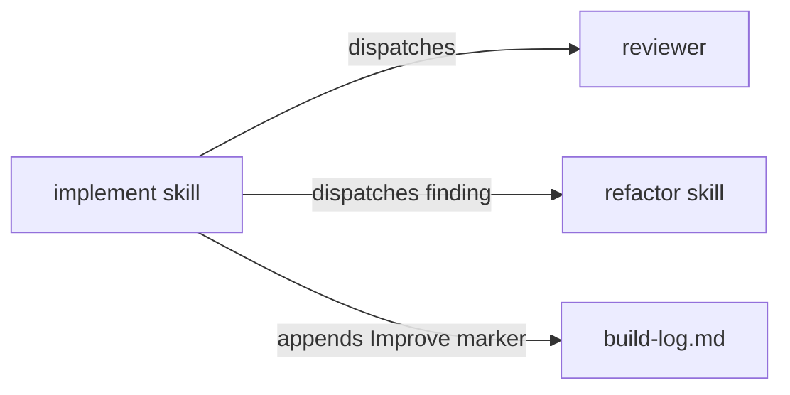

# Execution Plan - improvement loops

> Every requirement is traceable to a user story or acceptance criterion.

**Skill:** [plan](../skills/ravintio-plan/SKILL.md)
**Feature:** 0000202-improvement-loops
**Version:** 0.24.0
**Status:** active

## Active Skills

| Skill | Scope | Purpose |
|-------|-------|---------|
| None | none | none |

## Functional Requirements Directory

Functional requirements are split into individual files, one user story per file, at `plan/current/requirements/`.

| File | Requirement |
|------|------------|
| [req-001-improvement-loop.md](requirements/req-001-improvement-loop.md) | The implement and refactor skills run a capped improvement loop after GREEN |
| [req-002-improve-marker-and-docs.md](requirements/req-002-improve-marker-and-docs.md) | The standard lists the Improve marker and the living docs name the loop |

## Non-Functional Requirements

| ID | Category | Requirement | Target | Measurement |
|----|----------|------------|--------|-------------|
| NFR-001 | Cost | The loop is bounded | At most 2 cycles per requirement | A test reads the cap in the implement skill |

## API Summary

No network API.

## Data Model Summary

No datastore. No schema change.

## Component Interactions

## Concurrency plan

Batch 1 holds two units that write disjoint files. Batch 2 holds the docs unit, which describes what batch 1 builds.

| Unit | Depends on | Writes | Batch | Sequential reason |
|------|------------|--------|-------|-------------------|
| U1-loop-skills | none | `ravintio-zero/skills/ravintio-implement/SKILL.md`, `ravintio-zero/skills/ravintio-refactor/SKILL.md`, `ravintio-zero/tests/test-0000202-req-001-improvement-loop.sh` | 1 | |
| U2-marker-standard | none | `ravintio-zero/standards/workflow-governance-standards.md`, `ravintio-zero/tests/test-0000202-req-002-improve-marker.sh` | 1 | |
| U3-living-docs | U1-loop-skills, U2-marker-standard | `ravintio-zero/component.yml`, `docs/architecture-overview.md`, `ravintio-zero/pipeline-reference.md` | 2 | Describes the finished behaviour of U1 and U2, so it reads their final wording. |

## Assumptions

| ID | Assumption | Impact if Wrong |
|----|-----------|----------------|
| A-001 | A reviewer in a fresh context gives an independent read | Cycles find nothing and stop early |

## Open Questions

None.
