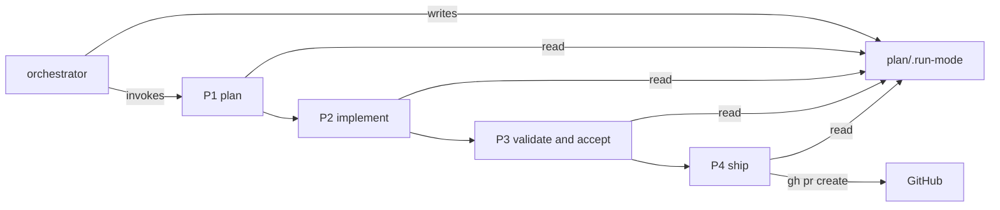

# Execution Plan - autonomous-mode-and-prefixes

> Every requirement must be traceable to a user story or acceptance criterion.

**Skill:** [plan](../skills/planifest-plan/SKILL.md)
**Feature:** 0000042-autonomous-mode-and-prefixes
**Version:** 0.9.0
**Status:** active

## Active Skills

| Skill | Scope | Purpose |
|-------|-------|---------|
| None | | No capability skill applies |

## Functional Requirements Directory

Each file follows the naming convention `req-{NNN}-{kebab-slug}.md` and the [Requirement Template](../../planifest-zero/templates/requirement.template.md).

| File | Requirement | Source | Points |
|------|------------|--------|--------|
| [req-001-run-modes-gated-autonomous.md](requirements/req-001-run-modes-gated-autonomous.md) | `gated` and `autonomous` replace `interactive` and `continuous`, with four exception stops | US-001, US-002 | 4 |
| [req-002-phase-numbers-and-prefixes.md](requirements/req-002-phase-numbers-and-prefixes.md) | Phases P0 to P4 and the five message prefixes | US-003 | 4 |
| [req-003-product-name-planifest-zero.md](requirements/req-003-product-name-planifest-zero.md) | `name: "Planifest Zero"` in both manifests | US-004 | 1 |
| [req-004-remove-framework-wording.md](requirements/req-004-remove-framework-wording.md) | No file describes or names Planifest Zero as a framework | US-005 | 4 |

REQ-001 covers two user stories. The two stories share one question, one file, and one set of gate rules, so one requirement keeps them together.

## Implementation order

Several requirements edit the same files, so P2 runs them in this order:

1. REQ-002 renumbers every phase cite. REQ-001 and REQ-004 then edit text that already uses the new numbers.
2. REQ-001 and REQ-003 run in parallel. They touch different files, apart from the orchestrator skill, which only REQ-001 edits for run modes.
3. REQ-004 runs last. It renames identifiers per ADR-004 and adds the allowlist test.

Inside REQ-004, subagents split by directory so no two edit one file.

## Non-Functional Requirements

| ID | Category | Requirement | Target | Measurement |
|----|----------|------------|--------|-------------|
| NFR-001 | Consistency | Phase cites stay inside P0 to P4 | 0 cites of P5 to P9 or a letter prefix outside history | Grep guard test from REQ-002 |
| NFR-002 | Consistency | "Framework" never names Planifest Zero | 0 lines outside the allowlist and history | Allowlist test from REQ-004 |
| NFR-003 | Reliability | The full suite passes | 0 failures in `run-tests.sh` and `run-tests.ps1` | CI on the pull request |
| NFR-004 | Security | An unmitigated critical or high finding stops an autonomous run | Stop in 100% of cases | REQ-001 test asserts the stop rule in the validate-and-accept skill |

## API Summary

Not applicable. Planifest Zero exposes no API.

## Data Model Summary

| Entity | Owner Component | Key Fields | Relationships |
|--------|----------------|------------|--------------|
| `plan/.run-mode` | planifest-zero (orchestrator skill) | one value: `gated` or `autonomous` | Read by every phase skill |
| `plan/current/build-log.md` | planifest-zero (orchestrator skill) | `### P<n>: {Phase Name}` blocks, n from 0 to 4 | Each phase skill appends its own block |

## Component Interactions

## Assumptions

Each is a risk item with likelihood: medium.

| ID | Assumption | Impact if Wrong |
|----|-----------|----------------|
| A-003 | No other repo installs Planifest Zero. | Another install breaks on the renamed identifiers and run-mode values. |
| A-004 | Tests keep names that carry old feature ids, unless the name calls Planifest Zero a framework. | A name such as `continuous-run-p1-p3` misleads a reader. |

## Open Questions

None. The human answered every fork in discovery.
