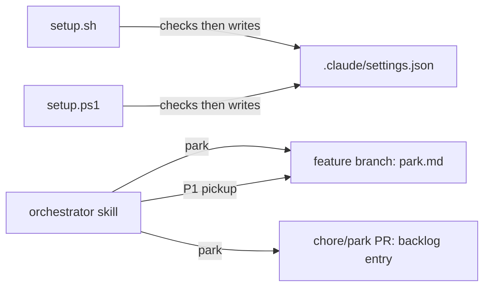

# Execution Plan - setup-json-checks-and-park

> Every requirement must be traceable to a user story or acceptance criterion.

**Skill:** [plan](../skills/planifest-plan/SKILL.md)
**Feature:** 0000040-setup-json-checks-and-park
**Version:** 0.7.0
**Status:** active

## Active Skills

None.

## Functional Requirements Directory

Functional requirements are split into individual files, one user story per file, at `plan/current/requirements/`.

| File | Requirement |
|------|------------|
| [req-001-setup-sh-shape-check.md](requirements/req-001-setup-sh-shape-check.md) | `setup.sh` stops on valid JSON that is not a settings object, with one fixed line and an unchanged file (US-001) |
| [req-002-setup-ps1-shape-check.md](requirements/req-002-setup-ps1-shape-check.md) | `setup.ps1` gives the same line for those inputs and for case-duplicate keys (US-002) |
| [req-003-linear-json-check.md](requirements/req-003-linear-json-check.md) | `Test-JsonText` runs in linear time and stops at depth 1024 (US-003) |
| [req-004-park-command.md](requirements/req-004-park-command.md) | Park shelves a feature on its branch, files a parked backlog entry by chore PR, and returns to `main` (US-004) |
| [req-005-parked-pickup.md](requirements/req-005-parked-pickup.md) | P1 backlog pickup resumes or discards a parked feature (US-005) |

## Non-Functional Requirements

| ID | Category | Requirement | Target | Measurement |
|----|----------|------------|--------|-------------|
| NFR-001 | Security | Setup never prints `settings.json` contents or parser text | 0 bytes of a planted value in stdout or stderr | Planted-value cases in the `.sh` and `.ps1` suites |
| NFR-002 | Performance | `Test-JsonText` cost grows linearly with input length | 100,000 levels of nesting fail in under 5 seconds | Timed case in the `.ps1` suite |
| NFR-003 | Parity | Both scripts print the same line for the shared cases | Identical stderr and exit code | The same cases in both suites |
| NFR-004 | Regression | No suite breaks | 0 failing suites locally and in CI | `planifest-zero/tests/run-tests.sh` and GitHub Actions |

## API Summary

Not applicable. The feature changes no API.

## Data Model Summary

Not applicable. The component owns no data store. Setup edits the consumer's `.claude/settings.json`. The orchestrator writes `plan/current/park.md` and one backlog entry.

## Component Interactions

## Delivery order

1. One implementer builds req-001 in `setup.sh` with the `.sh` suite.
2. A second implementer builds req-002 and req-003 in `setup.ps1` with the `.ps1` suite, in parallel. Both change the same check path.
3. A third implementer builds req-004 and req-005 in the orchestrator skill and the new park template, with a text suite, in parallel. Both edit the same skill sections.

## Assumptions

| ID | Assumption | Impact if Wrong |
|----|-----------|----------------|
| A-001 | `gh` is installed and authenticated when park runs | Park stops after pushing the branch, and the human files the PR |
| A-002 | PowerShell 5.1 and 7 both throw on case-duplicate keys in `ConvertFrom-Json` | The req-002 test needs a version guard |

## Open Questions

None.
